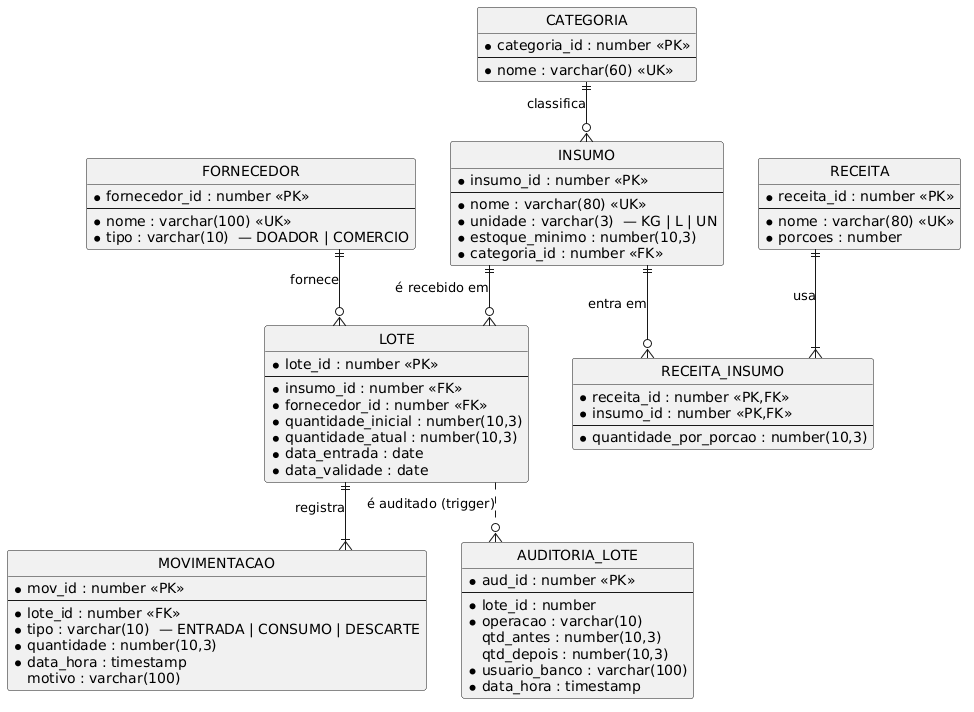
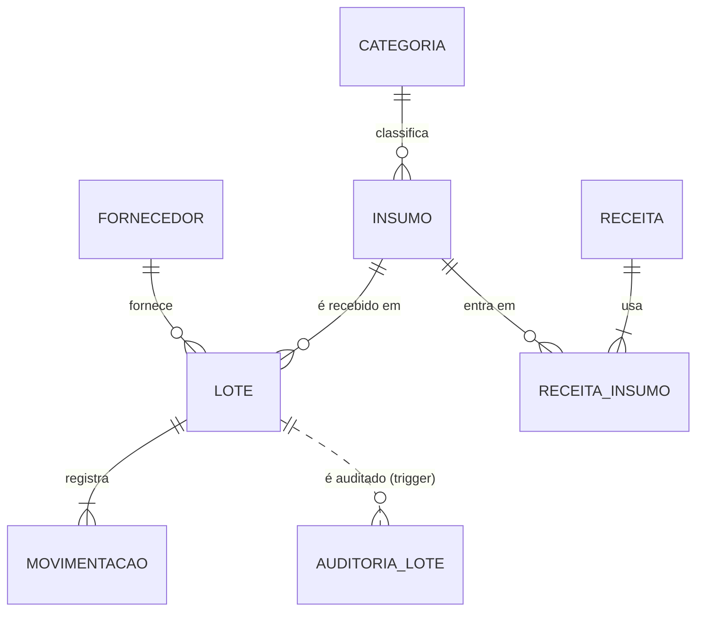

# DespensaViva

Banco de dados de uma **cozinha comunitária**: os insumos chegam em **lotes com validade**, e o consumo segue **FEFO** (*first expired, first out*: o lote que vence primeiro sai primeiro, e lote vencido nunca sai). A mesma solução roda em **PostgreSQL 17 e Oracle XE 21**, com procedures, triggers, 10 consultas analíticas, índices medidos e duas aplicações (**Python** e **Java**).

> **Projeto de referência da A3 de Banco de Dados.** Use como guia, não como modelo para copiar: o seu tema é outro. O grupo e as sessões com o agente de IA são fictícios; **os scripts, os testes, as medições e os erros descritos foram executados de verdade**, nos dois bancos.

## Como rodar (só precisa do Docker)

```bash
docker compose up -d --wait                          # sobe PostgreSQL e Oracle já com esquema, dados, procedures, triggers e índices
docker compose run --rm testes                       # 152 testes (76 cenários x 2 bancos)
docker compose --profile apps run --rm app-python    # aplicação Python (psycopg + oracledb)
docker compose --profile apps run --rm app-java      # aplicação Java (JDBC)
docker compose run --rm testes python scripts/mutacao.py     # teste de mutação dos scripts SQL (2 min)
docker compose run --rm testes python performance/medir.py   # planos e tempos antes/depois dos índices
docker compose down -v                               # apaga os dados; a próxima subida recarrega os scripts
```

O **Oracle XE** leva de 1 a 2 minutos para ficar pronto na **primeira** subida (o `--wait` espera). Portas ocupadas? `PG_PORT=5433 ORACLE_PORT=1522 docker compose up -d`. A primeira execução do `app-java` baixa as dependências do Maven.

Para abrir os bancos num cliente (DBeaver, SQL Developer): PostgreSQL em `localhost:5432`, banco `despensa`, usuário `despensa` / `despensa_pwd`; Oracle em `localhost:1521`, serviço `XEPDB1`, usuário `despensa` / `despensa_pwd`. **Senhas de laboratório**: em produção, a senha fica em variável de ambiente, fora do Git.

## Domínio e regras de negócio

| ID | Regra | Onde é aplicada |
|---|---|---|
| RN-01 | **FEFO:** o consumo sai do lote que vence primeiro; lote vencido nunca é consumido | `consumir_insumo` (cursor ordenado por validade) |
| RN-02 | A entrada exige validade de **pelo menos 3 dias** à frente | `registrar_entrada_lote` **e** `trg_lote_validade` (quem insere direto também é barrado) |
| RN-03 | Pedido maior que o saldo **não vencido** é recusado por inteiro (nada é consumido); saldo nunca fica negativo | `consumir_insumo` + `ck_lote_atual` |
| RN-04 | Insumo com saldo abaixo do **estoque mínimo** entra no alerta de reposição | Consulta Q06 |
| RN-05 | Lote que vence em **até 7 dias** é "prioritário" | Consulta Q02 |

## Modelo (DER)



Fontes: [`der/despensa.puml`](der/despensa.puml) (PlantUML) e [`der/despensa.mmd`](der/despensa.mmd) (Mermaid, renderiza no GitHub).



### Decisões de design

| Decisão | Justificativa |
|---|---|
| **`LOTE` separado de `INSUMO`** | O saldo e a validade pertencem ao **lote**, não ao insumo: sem isso não existe FEFO. O saldo do insumo é a soma dos lotes não vencidos (consulta Q01) |
| **`RECEITA_INSUMO` como entidade associativa** | N:M entre receita e insumo, com atributo próprio (`quantidade_por_porcao`) |
| **PK artificial por identidade** (`GENERATED BY DEFAULT AS IDENTITY`) | Sintaxe igual nos dois bancos; `UNIQUE` no nome natural (`uk_insumo_nome`) garante a unicidade do mundo real |
| **`CHECK` em `tipo`, `unidade` e quantidades** | Valores válidos garantidos no banco, independente de qualquer aplicação |
| **`ON DELETE` explícito em toda FK** | `CASCADE` só em `receita_insumo -> receita` (apagar a receita leva os ingredientes); o resto bloqueia. **Oracle não tem `RESTRICT`**: omitir a cláusula bloqueia do mesmo jeito (`ORA-02292`) |
| **Regra de 3 dias em procedure E trigger** | Defesa em profundidade: a procedure dá a mensagem cedo; o trigger protege quem faz `INSERT` direto. O teste de mutação mostra a redundância (M01) |
| **Procedures sem `COMMIT`** | Quem chama decide a transação e pode desfazer tudo (os testes e a demonstração usam `ROLLBACK`) |
| **Auditoria por trigger em tabela própria** | Não depende de a aplicação lembrar de registrar; `UPDATE OF quantidade_atual` evita ruído |
| **Índices em arquivo separado (`04_indices.sql`)** | Permite medir ANTES e DEPOIS (`performance/medir.py`) |
| **Datas relativas a hoje nos dados de exemplo** | As consultas dão o mesmo resultado em qualquer dia (e os testes não "vencem") |
| **Códigos de erro `DESPENSA-00x` iguais nos dois bancos** | A aplicação trata o erro de negócio da mesma forma, venha de onde vier |

## Estrutura

```
despensa-viva/
├── README.md · AGENTS.md · opencode.json · CHANGELOG.md
├── docker-compose.yml          # postgres, oracle, testes, app-python, app-java
├── der/                        # despensa.puml · despensa.mmd · despensa.png
├── postgresql/                 # 01_ddl · 02_inserts · 03_consultas · 04_indices
├── oracle/                     # os mesmos quatro arquivos, em Oracle
├── procedures/                 # postgresql_procedures.sql · oracle_procedures.sql (2 procedures + 2 triggers cada)
├── performance/                # carga em massa, medir.py e explain_antes_depois.txt (planos REAIS)
├── python/                     # despensa_app.py (psycopg + oracledb)
├── java/                       # Maven: DespensaApp.java (JDBC) + Dockerfile
├── tests/                      # pytest: o mesmo teste roda nos dois bancos
├── scripts/                    # mutacao.py
└── docker/                     # scripts de inicialização dos bancos e Dockerfile do Python
```

## O que foi testado

152 testes pytest, **76 cenários executados nos dois bancos** (`tests/conftest.py` parametriza a conexão):

| Arquivo | Cenários × 2 | O que verifica |
|---|---:|---|
| `test_ddl.py` | 15 | 8 tabelas; as 28 constraints têm nome (`pk_`, `uk_`, `fk_`, `ck_`); `ON DELETE` de cada FK; CHECKs, UNIQUE e FK barram o dado inválido |
| `test_dados.py` | 4 | Contagens, saldo de cada lote = entrada − consumos, lotes vencidos e a vencer existem |
| `test_procedures.py` | 26 | Entrada nos limites de 2 e 3 dias; FEFO entre lotes; consumo exatamente no limite do lote e do saldo; **atomicidade** (14,001 kg quando há 14 kg não consome nada); lote vencido ignorado; lote que vence **hoje** ainda vale; lote zerado é pulado |
| `test_triggers.py` | 11 | Validação com 2 e 3 dias; auditoria com saldo antes e depois; `UPDATE OF` só audita saldo; usuário do banco; recusa não deixa rastro |
| `test_consultas.py` | 14 | Cada uma das 10 consultas devolve o resultado esperado, **o mesmo nos dois bancos**; fronteiras do vencimento e da Q09 |
| `test_indices.py` | 1 | Os 3 índices existem, nas colunas e na ordem certas |
| `test_concorrencia.py` | 1 | **Dois operadores** pedem 8 kg de um lote de 10 kg ao mesmo tempo: só um é atendido |
| `test_app_python.py` | 4 | A aplicação Python: roteiro, erro de negócio, transação reutilizável depois do erro, `Decimal` |

### Teste de mutação dos scripts SQL (`scripts/mutacao.py`)

Aplica **um defeito por vez** (um `>=` vira `>`, um filtro some, um `JOIN` troca), **recria o esquema do zero** num banco descartável e roda a suíte. Se nada fica vermelho, o mutante sobreviveu.

| M01 | entrada aceita validade de 2 dias (procedure) | equivalente* | equivalente* |
| M02 | trigger de validade aceita 2 dias | detectado | detectado |
| M03 | FEFO invertido (vence DEPOIS sai primeiro) | detectado | detectado |
| M04 | lote que vence HOJE passa a ser tratado como vencido (laço) | detectado | detectado |
| M05 | laço volta a visitar lote zerado | detectado | detectado |
| M06 | some a conferência final (DEF-BD-01) | detectado | detectado |
| M07 | saldo exatamente igual ao pedido é recusado | detectado | detectado |
| M08 | some o FOR UPDATE (sem lock de linha) | detectado | n/a |
| M09 | auditoria grava o saldo novo no lugar do antigo | detectado | detectado |
| M10 | auditoria dispara em qualquer UPDATE | detectado | detectado |
| M11 | CHECK deixa o saldo passar da quantidade inicial | detectado | detectado |
| M12 | apagar receita deixa de levar os ingredientes | detectado | detectado |
| M13 | CHECK de tipo de fornecedor aceita 'OUTRO' | detectado | n/a |
| M14 | some a UNIQUE do nome do insumo | detectado | n/a |
| M15 | Q01 trata o lote que vence hoje como vencido | detectado | detectado |
| M16 | Q02 janela de 8 dias em vez de 7 | detectado | detectado |
| M17 | Q03 mostra só os 4 primeiros | detectado | detectado |
| M18 | Q04 vira 'insumos já consumidos' | detectado | detectado |
| M19 | Q05 acumula sem separar por insumo | detectado | detectado |
| M20 | Q06 alerta também quando saldo = mínimo | detectado | detectado |
| M21 | Q09 calcula para 40 porções em vez de 50 | detectado | detectado |
| M22 | Q10 conta também o lote que vence hoje como vencido | detectado | detectado |
| M23 | Q03 troca RANK() por ROW_NUMBER() | detectado | detectado |
| M01 | entrada aceita validade de 2 dias (procedure) | equivalente* | equivalente* |
| M02 | trigger de validade aceita 2 dias | detectado | detectado |
| M03 | FEFO invertido (vence DEPOIS sai primeiro) | detectado | detectado |
| M04 | lote que vence HOJE passa a ser tratado como vencido (laço) | detectado | detectado |
| M05 | laço volta a visitar lote zerado | detectado | detectado |
| M06 | some a conferência final (DEF-BD-01) | detectado | detectado |
| M07 | saldo exatamente igual ao pedido é recusado | detectado | detectado |
| M08 | some o FOR UPDATE (sem lock de linha) | detectado | n/a |
| M09 | auditoria grava o saldo novo no lugar do antigo | detectado | detectado |
| M10 | auditoria dispara em qualquer UPDATE | detectado | detectado |
| M11 | CHECK deixa o saldo passar da quantidade inicial | detectado | detectado |
| M12 | apagar receita deixa de levar os ingredientes | detectado | detectado |
| M13 | CHECK de tipo de fornecedor aceita 'OUTRO' | detectado | n/a |
| M14 | some a UNIQUE do nome do insumo | detectado | n/a |
| M15 | Q01 trata o lote que vence hoje como vencido | detectado | detectado |
| M16 | Q02 janela de 8 dias em vez de 7 | detectado | detectado |
| M17 | Q03 mostra só os 4 primeiros | detectado | detectado |
| M18 | Q04 vira 'insumos já consumidos' | detectado | detectado |
| M19 | Q05 acumula sem separar por insumo | detectado | detectado |
| M20 | Q06 alerta também quando saldo = mínimo | detectado | detectado |
| M21 | Q09 calcula para 40 porções em vez de 50 | detectado | detectado |
| M22 | Q10 conta também o lote que vence hoje como vencido | detectado | detectado |
| M23 | Q03 troca RANK() por ROW_NUMBER() | detectado | detectado |

**23 mutantes × 2 bancos = 43 execuções** (o M08, o M13 e o M14 só existem em um dos bancos): **41 detectadas, 2 equivalentes, 0 sobreviventes**, em 2 min. \* O M01 é equivalente: o trigger repete a regra e barra com a mesma mensagem (defesa em profundidade).

**Na primeira rodada sobreviveram 3 mutantes de verdade** (M15 e M22, sobre o lote que vence **hoje**, e M21, sobre as 40 × 50 porções da Q09), fora o M01, equivalente. Os dados de exemplo não tinham lote que vence hoje nem receita que cabe em 40 porções e não em 50. O M23 (`RANK()` × `ROW_NUMBER()`) só passou a ser detectado depois que o ranking ganhou um **empate** (Cebola e Sal, 5 kg cada). A correção foi **acrescentar dados e testes de fronteira**, não afrouxar as consultas.

## Desempenho: os índices (Etapa 5)

200.000 lotes e 400.000 movimentações num esquema descartável, mediana de 100 execuções, **planos reais** em [`performance/explain_antes_depois.txt`](performance/explain_antes_depois.txt):

| Banco | Consulta | Sem índice | Com índice | Ganho |
|---|---|---:|---:|---:|
| PostgreSQL | FEFO: lotes de um insumo por validade | 11.41 ms | 0.28 ms | 97.6% (41x) |
| PostgreSQL | FK: movimentações de um lote | 12.50 ms | 0.04 ms | 99.6% (281x) |
| Oracle | FEFO: lotes de um insumo por validade | 2.60 ms | 0.32 ms | 87.5% (8x) |
| Oracle | FK: movimentações de um lote | 4.61 ms | 0.04 ms | 99.1% (109x) |

| | Sem índice | Com índice |
|---|---|---|
| **PostgreSQL** (FEFO) | `Parallel Seq Scan on lote` + `Sort` | `Bitmap Index Scan on idx_lote_insumo_validade` |
| **PostgreSQL** (FK) | `Parallel Seq Scan on movimentacao` | `Index Scan using idx_mov_lote` |
| **Oracle** (FEFO) | `TABLE ACCESS FULL` | `INDEX RANGE SCAN` em `IDX_LOTE_INSUMO_VALIDADE` |
| **Oracle** (FK) | `TABLE ACCESS FULL` | `INDEX RANGE SCAN` em `IDX_MOV_LOTE` |

Os tempos são da máquina do autor, de ponta a ponta pela rede local do Docker (não é o `actual time` do `EXPLAIN`): servem para **comparar antes e depois**, não como promessa de latência.

## Dificuldades e aprendizados

**Diferenças PostgreSQL × Oracle que mordem:**

| Ponto | PostgreSQL | Oracle |
|---|---|---|
| `ON DELETE RESTRICT` | Existe | **Não existe** (`ORA-00905`): omita a cláusula |
| Data de hoje | `CURRENT_DATE` | `TRUNC(SYSDATE)` (`SYSDATE` traz hora) |
| Tipos | `VARCHAR`, `NUMERIC`, `INTEGER` | `VARCHAR2`, `NUMBER` |
| Procedure | `CREATE PROCEDURE ... LANGUAGE plpgsql AS $$ ... $$` · `CALL` | `CREATE PROCEDURE ... IS ... END;` + linha `/` · `EXEC` ou bloco |
| Trigger | função + `CREATE TRIGGER ... EXECUTE FUNCTION` · `NEW`/`OLD` · `TG_OP` | corpo no próprio `CREATE TRIGGER` · `:NEW`/`:OLD` · `INSERTING` |
| Erro de negócio | `RAISE EXCEPTION '...'` | `RAISE_APPLICATION_ERROR(-20001..-20999, '...')` |
| Erro dentro da transação | **A transação inteira fica abortada** (use `SAVEPOINT`) | Só o comando que falhou é desfeito |
| Inserir id à mão em coluna `IDENTITY` | Depois, `setval` nas sequências | Depois, `MODIFY ... GENERATED ... (START WITH LIMIT VALUE)` |
| Script no `sqlplus` | — | Comentário `--` **depois** do `;` na mesma linha dá `ORA-00933` |

**A identidade não volta no `ROLLBACK`.** Um teste que assumia "o próximo lote é o 14" falha depois de qualquer rollback anterior. Use `MAX(lote_id)`.

**Concorrência de verdade, com duas conexões.** A `consumir_insumo` original lia o saldo, fazia o laço com `FOR UPDATE` e... não conferia se sobrou pedido. Dois operadores pedindo 8 kg de um lote de 10 kg: o segundo, depois de esperar o lock, enxergava 2 kg, entregava 2 e **dizia que deu certo**. Só o teste com duas sessões mostrou. A correção é uma linha (conferência final) e um teste que a protege (o mutante M06).

## Uso de IA

**Ferramenta e modelo:** OpenCode + Nemotron 3 Ultra (`:free`) via OpenRouter, na configuração da Aula 01B. **Skills:** `grilling`, `to-spec`, `to-tickets`, `caveman-review`. **Configuração versionada:** `opencode.json` (push negado, comandos com `ask`) e `AGENTS.md`.

> **Nota do exemplo:** os registros 1 a 5 descrevem erros que **de fato ocorreram** na construção deste exemplo. Os registros 6, 7 e 8 são ilustrativos do formato (o erro do 6 foi verificado: `ORA-00905`).

### Registros (8 registros, 7 tipos de artefato)

| # | Artefato | Pedido (resumo) | O que o agente errou ou omitiu | O que o grupo fez |
|---|---|---|---|---|
| 1 | `oracle/02_inserts.sql` | Converter os inserts do PostgreSQL para Oracle | Deixou `+ TIME '08:00'` (`ORA-01861`) e comentários `-- ...` depois do `;` (`ORA-00933`); o init do contêiner parou no primeiro erro | Trocou por `+ 8/24`, moveu os comentários para a linha de cima e passou a rodar o script do zero no Oracle a cada mudança |
| 2 | `procedures/*_procedures.sql` | Procedure de consumo FEFO com `FOR UPDATE` | Não conferia se **sobrou pedido** depois do laço: com dois operadores simultâneos entregava parte e dizia "sucesso" | Escreveu o teste de **duas sessões** primeiro (vermelho nos dois bancos); acrescentou a conferência final e o mutante M06 |
| 3 | `python/despensa_app.py` | Chamar as procedures com psycopg | Passou `float` (`procedure consumir_insumo(smallint, double precision, unknown) does not exist`) e esqueceu que um erro **aborta a transação** no PostgreSQL (`InFailedSqlTransaction`) | `Decimal` para `NUMERIC` e `SAVEPOINT` antes de cada chamada, com teste para os dois casos |
| 4 | `tests/test_procedures.py` | Testar a entrada de lote | Esperou `lote_id = 14`, mas a identidade não volta no `ROLLBACK` | Passou a consultar `MAX(lote_id)` |
| 5 | `tests/test_consultas.py` | Resultado esperado das 10 consultas | Os dados não tinham fronteiras (vence hoje, empate no ranking, 40 × 50 porções): 3 mutantes sobreviveram, e o do `RANK()` só morreu com um empate | Acrescentou dados e testes de fronteira; todos passaram a ser detectados |
| 6 | `oracle/01_ddl.sql` | Rascunho do DDL Oracle a partir do PostgreSQL | Manteve `ON DELETE RESTRICT` nas FKs (`ORA-00905`) | Omitiu a cláusula e documentou a diferença na tabela acima |
| 7 | `performance/explain_antes_depois.txt` | Interpretar o plano antes e depois | Afirmou "queda de 90%" sem os tempos; no Oracle disse que o índice "sempre" é usado | Colou os planos **reais** e os tempos medidos (ganho de 87,5% a 99,6%) |
| 8 | `README.md` | Revisar o README contra o checklist | Listou a seção "Uso de IA" mas sem nenhum erro real | Preencheu com os erros que de fato ocorreram e a reflexão abaixo |

### Reflexão do grupo

- **Onde a IA mais ajudou:** converter o DDL e os inserts entre os dois dialetos, e escrever a grade de cenários dos testes: trabalho repetitivo que o grupo revisou.
- **Onde mais errou:** em tudo que **só aparece rodando no outro banco** (dialeto) e em tudo que **só aparece com duas sessões** (concorrência). Nenhum erro foi visto lendo o código; todos apareceram ao executar.
- **O que faria diferente:** escrever o teste de concorrência e o de mutação **antes** de considerar a procedure pronta.
- **Regra que ficou no `AGENTS.md`:** "todo SQL escrito vale depois de executado nos dois bancos".

### Defesa oral

Todos os integrantes sabem explicar qualquer constraint, consulta, procedure ou trigger: escritos por nós ou pelo agente.

## Licença

Uso didático.
