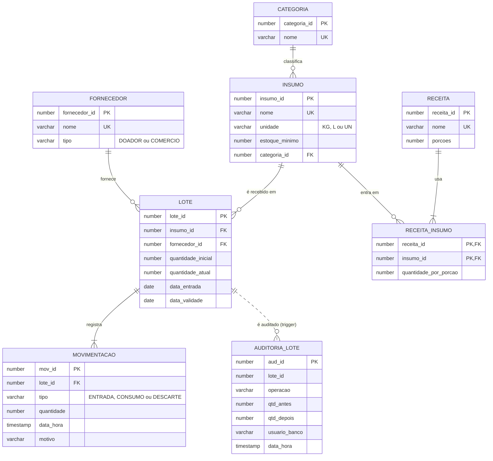

# A3 — Projeto Exemplo: DespensaViva  

> **Documento de referência.** Este projeto é um exemplo completo de A3 para a disciplina de Banco de Dados. Ele mostra o nível de profundidade esperado em cada critério da rubrica. Use-o como guia, **não como modelo a ser copiado**: o seu projeto deve refletir o problema e as decisões do seu grupo.  
>  
> **O que é real e o que é ilustrativo.** Os scripts SQL, as procedures, os 152 testes, o teste de mutação, os planos de execução, os tempos e os erros descritos abaixo foram **produzidos e executados de verdade, nos dois bancos** (PostgreSQL 17 e Oracle XE 21, em Docker). O repositório completo está em [`a3-despensaviva`](https://github.com/giovanebarcelos/bd-sandbox/tree/main/class32/a3-despensaviva). O grupo, as datas e os autores do `git log` são **fictícios**: o histórico foi **reconstruído em ordem lógica** (a procedure aparece primeiro com o defeito, depois com a correção), e nem todo commit intermediário tem a suíte verde. Os registros de uso de IA misturam erros reais da construção (marcados) e linhas ilustrativas. O exemplo foi elaborado pelo professor com apoio de IA (Claude Code); no seu projeto, a seção **Uso de IA** deve contar o que realmente aconteceu.  
>  
> **O que o exemplo não prova:** os tempos de índice são de uma máquina e de um contêiner (comparam antes e depois, não prometem latência); o Oracle foi o XE 21 (limites de memória e de tamanho do XE); a execução foi feita com as imagens já baixadas.  

---  

## Identificação do Projeto  

| Campo | Conteúdo |  
|---|---|  
| **Título** | DespensaViva — estoque com validade de uma cozinha comunitária |  
| **Grupo** | Bia · Caio · Duda (fictícios) |  
| **Período** | 2026/2 |  
| **Tema** | Insumos em lotes com validade; consumo FEFO (o que vence primeiro sai primeiro) |  
| **SGBDs** | PostgreSQL 17 e Oracle XE 21 (imagem `gvenzl/oracle-xe`) |  
| **Aplicações** | Python 3.12 (`psycopg`, `python-oracledb`) e Java 21 (JDBC) |  
| **Entrega** | `docker compose` com os dois bancos, 152 testes e 2 aplicações |  
| **Repositório** | `github.com/<grupo>/despensaviva` (tag `v1.0.0`) — exemplo em [`a3-despensaviva`](https://github.com/giovanebarcelos/bd-sandbox/tree/main/class32/a3-despensaviva) |  

---  

## 1. Contexto, Problema e Escolha do Tema  

### 1.1 O problema  

A cozinha comunitária recebe doações e compras de arroz, feijão, hortaliças e laticínios. Os alimentos vêm em **lotes**, cada um com a sua validade. Hoje o controle é uma planilha por insumo, e surgem três falhas: **usa-se o lote novo e o antigo vence na prateleira** (desperdício), **consome-se lote vencido** por descuido e **aceita-se doação que já chega quase vencida**, sem ter como usá-la.  

**Pergunta central:** como garantir que o consumo siga o lote que vence primeiro, que lote vencido nunca saia e que a regra valha **mesmo para quem mexe direto no banco**?  

### 1.2 Regras de negócio  

| ID | Regra |  
|---|---|  
| RN-01 | **FEFO:** o consumo sai do lote que vence primeiro; lote vencido nunca é consumido |  
| RN-02 | A entrada exige validade de **pelo menos 3 dias** à frente |  
| RN-03 | Pedido maior que o saldo **não vencido** é recusado por inteiro; o saldo nunca fica negativo |  
| RN-04 | Insumo com saldo abaixo do **estoque mínimo** entra no alerta de reposição |  
| RN-05 | Lote que vence em **até 7 dias** é "prioritário" |  

### 1.3 Verificação do tema contra os critérios da A3  

| Critério | Como a DespensaViva atende |  
|---|---|  
| **Problema real e identificável** | Desperdício e consumo de lote vencido, relatados pela coordenadora da cozinha |  
| **3+ regras com número** | RN-02 (3 dias), RN-05 (7 dias), RN-04 (estoque mínimo), RN-03 (saldo ≥ 0) |  
| **6+ entidades e N:M** | 8 tabelas; `RECEITA_INSUMO` resolve o N:M entre receita e insumo |  
| **Procedure e trigger que importam** | O consumo altera 3 tabelas (`lote`, `movimentacao`, `auditoria_lote`); a regra de 3 dias vale também para `INSERT` direto |  
| **Originalidade** | Regras próprias da operação (FEFO, janela de 7 dias), não o domínio de biblioteca |  

---  

## 2. DER  

  



Fontes: [`der/despensa.puml`](https://github.com/giovanebarcelos/bd-sandbox/blob/main/class32/a3-despensaviva/der/despensa.puml) (PlantUML) e [`der/despensa.mmd`](https://github.com/giovanebarcelos/bd-sandbox/blob/main/class32/a3-despensaviva/der/despensa.mmd) (Mermaid).  

### 2.1 Cardinalidades (mín., máx.)  

| Relacionamento | Cardinalidade | Observação |  
|---|---|---|  
| Categoria — classifica — Insumo | (1,1) — (0,N) | Todo insumo tem categoria; categoria pode estar vazia |  
| Insumo — é recebido em — Lote | (1,1) — (0,N) | Um insumo cadastrado ainda pode não ter lote |  
| Fornecedor — fornece — Lote | (1,1) — (0,N) | |  
| Lote — registra — Movimentação | (1,1) — (1,N) | Todo lote nasce com a movimentação de ENTRADA |  
| Receita — usa — Insumo (via `RECEITA_INSUMO`) | (1,N) — (0,N) | Receita sem ingrediente não existe |  

### 2.2 Decisões de modelagem  

| Decisão | Justificativa |  
|---|---|  
| **`LOTE` separado de `INSUMO`** | O saldo e a validade pertencem ao **lote**, não ao insumo: sem isso não existe FEFO. O saldo do insumo é a soma dos lotes não vencidos (consulta Q01) |  
| **`RECEITA_INSUMO` como entidade associativa** | N:M entre receita e insumo, com atributo próprio (`quantidade_por_porcao`) |  
| **PK artificial por identidade** (`GENERATED BY DEFAULT AS IDENTITY`) | Sintaxe igual nos dois bancos; `UNIQUE` no nome natural (`uk_insumo_nome`) garante a unicidade do mundo real |  
| **`CHECK` em `tipo`, `unidade` e quantidades** | Valores válidos garantidos no banco, independente de qualquer aplicação |  
| **`ON DELETE` explícito em toda FK** | `CASCADE` só em `receita_insumo -> receita` (apagar a receita leva os ingredientes); o resto bloqueia. **Oracle não tem `RESTRICT`**: omitir a cláusula bloqueia do mesmo jeito (`ORA-02292`) |  
| **Regra de 3 dias em procedure E trigger** | Defesa em profundidade: a procedure dá a mensagem cedo; o trigger protege quem faz `INSERT` direto. O teste de mutação mostra a redundância (M01) |  
| **Procedures sem `COMMIT`** | Quem chama decide a transação e pode desfazer tudo (os testes e a demonstração usam `ROLLBACK`) |  
| **Auditoria por trigger em tabela própria** | Não depende de a aplicação lembrar de registrar; `UPDATE OF quantidade_atual` evita ruído |  
| **Índices em arquivo separado (`04_indices.sql`)** | Permite medir ANTES e DEPOIS (`performance/medir.py`) |  
| **Datas relativas a hoje nos dados de exemplo** | As consultas dão o mesmo resultado em qualquer dia (e os testes não "vencem") |  
| **Códigos de erro `DESPENSA-00x` iguais nos dois bancos** | A aplicação trata o erro de negócio da mesma forma, venha de onde vier |  

---  

## 3. DDL: Oracle e PostgreSQL  

Os scripts rodam **do zero** nos dois bancos (`docker compose up -d --wait`). A tabela central, `LOTE`, nos dois dialetos:  

`postgresql/01_ddl.sql`  

```sql  
CREATE TABLE lote (  
    lote_id            INTEGER GENERATED BY DEFAULT AS IDENTITY,  
    insumo_id          INTEGER       NOT NULL,  
    fornecedor_id      INTEGER       NOT NULL,  
    quantidade_inicial NUMERIC(10,3) NOT NULL,  
    quantidade_atual   NUMERIC(10,3) NOT NULL,  
    data_entrada       DATE          NOT NULL DEFAULT CURRENT_DATE,  
    data_validade      DATE          NOT NULL,  
    CONSTRAINT pk_lote         PRIMARY KEY (lote_id),  
    CONSTRAINT ck_lote_inicial CHECK (quantidade_inicial > 0),  
    CONSTRAINT ck_lote_atual   CHECK (quantidade_atual >= 0 AND quantidade_atual <= quantidade_inicial),  
    CONSTRAINT ck_lote_datas   CHECK (data_validade >= data_entrada),  
    CONSTRAINT fk_lote_insumo  FOREIGN KEY (insumo_id)     REFERENCES insumo (insumo_id)         ON DELETE RESTRICT,  
    CONSTRAINT fk_lote_forn    FOREIGN KEY (fornecedor_id) REFERENCES fornecedor (fornecedor_id) ON DELETE RESTRICT  
```  

`oracle/01_ddl.sql`  

```sql  
CREATE TABLE lote (  
    lote_id            NUMBER GENERATED BY DEFAULT AS IDENTITY,  
    insumo_id          NUMBER        NOT NULL,  
    fornecedor_id      NUMBER        NOT NULL,  
    quantidade_inicial NUMBER(10,3)  NOT NULL,  
    quantidade_atual   NUMBER(10,3)  NOT NULL,  
    data_entrada       DATE          DEFAULT TRUNC(SYSDATE) NOT NULL,  
    data_validade      DATE          NOT NULL,  
    CONSTRAINT pk_lote         PRIMARY KEY (lote_id),  
    CONSTRAINT ck_lote_inicial CHECK (quantidade_inicial > 0),  
    CONSTRAINT ck_lote_atual   CHECK (quantidade_atual >= 0 AND quantidade_atual <= quantidade_inicial),  
    CONSTRAINT ck_lote_datas   CHECK (data_validade >= data_entrada),  
    CONSTRAINT fk_lote_insumo  FOREIGN KEY (insumo_id)     REFERENCES insumo (insumo_id),  
    CONSTRAINT fk_lote_forn    FOREIGN KEY (fornecedor_id) REFERENCES fornecedor (fornecedor_id)  
```  

### 3.1 O que muda de um banco para o outro  

| Ponto | PostgreSQL | Oracle |  
|---|---|---|  
| Texto e número | `VARCHAR`, `NUMERIC(10,3)`, `INTEGER` | `VARCHAR2`, `NUMBER(10,3)`, `NUMBER` |  
| Valor padrão de data | `DEFAULT CURRENT_DATE` | `DEFAULT TRUNC(SYSDATE)` |  
| Ordem de `DEFAULT` e `NOT NULL` | Qualquer | `DEFAULT` **antes** de `NOT NULL` |  
| `ON DELETE RESTRICT` | Existe | **Não existe**: omitir a cláusula já bloqueia o `DELETE` do pai (`ORA-02292`) |  
| Identidade | `GENERATED BY DEFAULT AS IDENTITY` | O mesmo |  

O erro mais comum de quem usa o agente: copiar o DDL de um banco para o outro **sem executar**. No Oracle, `ON DELETE RESTRICT` dá:  

```  
ORA-00905: missing keyword  
```  

### 3.2 Constraints: 28, todas nomeadas  

8 `PRIMARY KEY` (`pk_`), 4 `UNIQUE` (`uk_`), 6 `FOREIGN KEY` (`fk_`) e 10 `CHECK` (`ck_`). Um teste (`test_toda_constraint_tem_nome_explicito`) consulta o **catálogo** dos dois bancos e falha se existir uma constraint sem o prefixo (`lote_insumo_id_fkey` e `SYS_C0012345` reprovam). O `ON DELETE` de cada FK também é conferido pelo catálogo: **`CASCADE` só em `receita_insumo → receita`; as outras 5 bloqueiam**.  

---  

## 4. Dados e Consultas  

### 4.1 Dados de exemplo  

13 lotes, 8 insumos, 23 movimentações, com **datas relativas a hoje** (`CURRENT_DATE - 30`), então as consultas dão o mesmo resultado em qualquer dia. O saldo de cada lote **confere com as movimentações** (teste `test_saldo_de_cada_lote_bate_com_entrada_menos_consumos`). Os dados têm **fronteiras de propósito**: lote que vence em 7 dias (dentro da janela) e em 8 (fora), saldo exatamente igual ao mínimo, empate no ranking, dois lotes vencidos com saldo.  

### 4.2 As 10 consultas (PostgreSQL)  

`postgresql/03_consultas.sql`  

```sql  
-- DespensaViva · PostgreSQL · 03_consultas.sql — 10 consultas analíticas.  
-- Separador "-- @Qnn" é lido pelos testes (tests/test_consultas.py); cada consulta termina em ponto e vírgula.  
-- Técnicas: JOIN (Q01,Q02,Q03,Q06,Q07,Q08,Q10) · window function (Q03,Q05,Q07,Q08) · agregação (Q01,Q03,Q06,Q07,Q10)  
--           anti-join (Q04) · divisão relacional (Q09) · ROLLUP (Q10)  

-- @Q01 Saldo atual de cada insumo (só lotes não vencidos). JOIN + LEFT JOIN + SUM + GROUP BY.  
SELECT i.nome, i.unidade, COALESCE(SUM(l.quantidade_atual), 0) AS saldo  
  FROM insumo i  
  LEFT JOIN lote l ON l.insumo_id = i.insumo_id AND l.data_validade >= CURRENT_DATE  
 GROUP BY i.insumo_id, i.nome, i.unidade  
 ORDER BY i.nome;  

-- @Q02 Lotes com saldo que vencem nos próximos 7 dias (RN-05: "prioritários"). JOIN + aritmética de datas.  
SELECT i.nome, l.lote_id, l.quantidade_atual, (l.data_validade - CURRENT_DATE) AS dias_restantes  
  FROM lote l  
  JOIN insumo i ON i.insumo_id = l.insumo_id  
 WHERE l.quantidade_atual > 0  
   AND l.data_validade BETWEEN CURRENT_DATE AND CURRENT_DATE + 7  
 ORDER BY dias_restantes, l.lote_id;  

-- @Q03 Top 5 insumos mais consumidos. JOIN + SUM + RANK() OVER.  
SELECT t.nome, t.total_consumido, t.ranking  
  FROM (SELECT i.nome,  
               SUM(m.quantidade) AS total_consumido,  
               RANK() OVER (ORDER BY SUM(m.quantidade) DESC) AS ranking  
          FROM movimentacao m  
          JOIN lote l   ON l.lote_id = m.lote_id  
          JOIN insumo i ON i.insumo_id = l.insumo_id  
         WHERE m.tipo = 'CONSUMO'  
         GROUP BY i.nome) t  
 WHERE t.ranking <= 5  
 ORDER BY t.ranking, t.nome;  

-- @Q04 Insumos nunca consumidos. Anti-join com NOT EXISTS.  
SELECT i.nome  
  FROM insumo i  
 WHERE NOT EXISTS (SELECT 1  
                     FROM movimentacao m  
                     JOIN lote l ON l.lote_id = m.lote_id  
                    WHERE l.insumo_id = i.insumo_id AND m.tipo = 'CONSUMO')  
 ORDER BY i.nome;  

-- @Q05 Consumo acumulado de cada insumo ao longo do tempo. SUM() OVER (PARTITION BY ... ORDER BY ...).  
SELECT i.nome, m.quantidade,  
       SUM(m.quantidade) OVER (PARTITION BY i.insumo_id ORDER BY m.data_hora, m.mov_id) AS acumulado  
  FROM movimentacao m  
  JOIN lote l   ON l.lote_id = m.lote_id  
  JOIN insumo i ON i.insumo_id = l.insumo_id  
 WHERE m.tipo = 'CONSUMO'  
 ORDER BY i.nome, m.data_hora, m.mov_id;  

-- @Q06 Insumos abaixo do estoque mínimo (RN-04: alerta de reposição). JOIN + GROUP BY + HAVING.  
SELECT i.nome, i.estoque_minimo, COALESCE(SUM(l.quantidade_atual), 0) AS saldo  
  FROM insumo i  
  LEFT JOIN lote l ON l.insumo_id = i.insumo_id AND l.data_validade >= CURRENT_DATE  
 GROUP BY i.insumo_id, i.nome, i.estoque_minimo  
HAVING COALESCE(SUM(l.quantidade_atual), 0) < i.estoque_minimo  
 ORDER BY i.nome;  

-- @Q07 Participação de cada fornecedor no total de lotes recebidos (%). Agregação dentro de window function.  
SELECT f.nome, f.tipo, COUNT(*) AS lotes,  
       ROUND(100.0 * COUNT(*) / SUM(COUNT(*)) OVER (), 1) AS percentual  
  FROM lote l  
  JOIN fornecedor f ON f.fornecedor_id = l.fornecedor_id  
 GROUP BY f.fornecedor_id, f.nome, f.tipo  
 ORDER BY lotes DESC, f.nome;  

-- @Q08 Lote que o FEFO consumiria primeiro, por insumo. ROW_NUMBER() OVER (PARTITION BY ...).  
SELECT t.nome, t.lote_id, t.dias_restantes  
  FROM (SELECT i.nome, l.lote_id, (l.data_validade - CURRENT_DATE) AS dias_restantes,  
               ROW_NUMBER() OVER (PARTITION BY l.insumo_id ORDER BY l.data_validade, l.lote_id) AS rn  
          FROM lote l  
          JOIN insumo i ON i.insumo_id = l.insumo_id  
         WHERE l.quantidade_atual > 0 AND l.data_validade >= CURRENT_DATE) t  
 WHERE t.rn = 1  
 ORDER BY t.nome;  

-- @Q09 Receitas que o estoque atual permite fazer para 50 porções. Divisão relacional: nenhum ingrediente em falta.  
SELECT r.nome  
  FROM receita r  
 WHERE NOT EXISTS (SELECT 1  
                     FROM receita_insumo ri  
                    WHERE ri.receita_id = r.receita_id  
                      AND ri.quantidade_por_porcao * 50 >  
                          (SELECT COALESCE(SUM(l.quantidade_atual), 0)  
                             FROM lote l  
                            WHERE l.insumo_id = ri.insumo_id AND l.data_validade >= CURRENT_DATE))  
 ORDER BY r.nome;  

-- @Q10 Desperdício: saldo de lotes VENCIDOS por categoria, com total geral. JOIN + GROUP BY ROLLUP.  
SELECT COALESCE(c.nome, 'TOTAL') AS categoria, SUM(l.quantidade_atual) AS saldo_vencido  
  FROM lote l  
  JOIN insumo i    ON i.insumo_id = l.insumo_id  
  JOIN categoria c ON c.categoria_id = i.categoria_id  
 WHERE l.data_validade < CURRENT_DATE AND l.quantidade_atual > 0  
 GROUP BY ROLLUP (c.nome)  
 ORDER BY c.nome NULLS LAST;  
```  

Em Oracle muda só a data de hoje (`TRUNC(SYSDATE)` no lugar de `CURRENT_DATE`) e o resto do texto é idêntico. **O resultado é o mesmo nos dois bancos** (teste `test_consulta_devolve_o_resultado_esperado`, parametrizado nas duas conexões).  

### 4.3 Resultados esperados (os mesmos nos dois bancos)  

| Consulta | Resultado | O que ensina |  
|---|---|---|  
| Q01 saldo por insumo | Arroz 68 · Feijão 45 · Tomate 14 · Leite 18 · Sal 5 · Cebola 7 · Alho 3 · Farinha **0** | O lote vencido **não conta**: a farinha tem 10 kg em estoque e saldo 0 |  
| Q02 vencem em até 7 dias | Tomate (2 dias), Leite (5), Tomate (**7**) | A janela é inclusiva: 7 dias entra, 8 não (o lote de alho, em 8 dias, fica de fora) |  
| Q03 top 5 consumo | Leite 18, Feijão 15, Arroz 12, Tomate 11, **Cebola 5 e Sal 5 (empate, os dois em 5º)** | `RANK()` devolve 6 linhas por causa do empate; `ROW_NUMBER()` devolveria 5 e sortearia quem sai |  
| Q04 nunca consumidos | Alho, Farinha de trigo | Anti-join com `NOT EXISTS` |  
| Q05 consumo acumulado | Arroz 5 → 12 · Feijão 10 → 15 · Leite 10 → 18 · Tomate 6 → 11 ... | `SUM() OVER (PARTITION BY ... ORDER BY ...)` |  
| Q06 abaixo do mínimo | Cebola (7 < 8), Farinha (0 < 5) | O alho, com saldo 3 = mínimo 3, **não** entra: `<`, não `<=` |  
| Q07 participação | Feira do Produtor 38,5% · Banco de Alimentos 23,1% · Mercado Bom Preço 23,1% · Padaria 15,4% | Agregação dentro de window: `SUM(COUNT(*)) OVER ()` |  
| Q08 lote que o FEFO usaria | Tomate: lote 5 · Leite: lote 8 · Arroz: lote 1 ... | `ROW_NUMBER() ... = 1` |  
| Q09 receitas possíveis (50 porções) | Arroz e feijão | A **sopa** pede 50 × 0,29 = **14,5 kg** de tomate, e há 14 kg |  
| Q10 desperdício | Grãos 10 · Laticínios 8 · TOTAL 18 | `ROLLUP` |  

Requisitos da rubrica: **JOIN** (Q01, Q02, Q03, Q05, Q06, Q07, Q08, Q10), **window function** (Q03, Q05, Q07, Q08) e **agregação** (Q01, Q03, Q06, Q07, Q10); um teste confere a presença das três técnicas.  

---  

## 5. Procedures e Triggers  

Duas procedures e dois triggers (a rubrica pede 2 e 1), nos dois dialetos. Mensagens de erro com **código estável** (`DESPENSA-001` a `-004`), iguais nos dois bancos, para a aplicação tratar sem olhar o banco. **Nenhuma procedure faz `COMMIT`.**  

### 5.1 PostgreSQL (PL/pgSQL)  

`procedures/postgresql_procedures.sql`  

```sql  
-- DespensaViva · PostgreSQL · procedures e triggers (PL/pgSQL)  
-- Códigos de erro (mesmos nos dois bancos, para a aplicação tratar igual):  
--   DESPENSA-001 quantidade deve ser positiva      DESPENSA-003 estoque insuficiente (não vencido)  
--   DESPENSA-002 validade mínima de 3 dias         DESPENSA-004 insumo ou fornecedor inexistente  
-- As procedures NÃO fazem COMMIT: quem chama decide a transação (e pode desfazer tudo).  

-- ---------------------------------------------------------------------------------------------  
-- Procedure 1: registra a entrada de um lote (RN-02: validade de pelo menos 3 dias à frente).  
-- ---------------------------------------------------------------------------------------------  
CREATE OR REPLACE PROCEDURE registrar_entrada_lote(  
    p_insumo_id     INTEGER,  
    p_fornecedor_id INTEGER,  
    p_quantidade    NUMERIC,  
    p_validade      DATE)  
LANGUAGE plpgsql AS $$  
DECLARE  
    v_lote_id INTEGER;  
BEGIN  
    IF p_quantidade IS NULL OR p_quantidade <= 0 THEN  
        RAISE EXCEPTION 'DESPENSA-001: a quantidade deve ser positiva' USING ERRCODE = 'P0001';  
    END IF;  
    IF p_validade < CURRENT_DATE + 3 THEN  
        RAISE EXCEPTION 'DESPENSA-002: a validade deve ser de pelo menos 3 dias a partir de hoje' USING ERRCODE = 'P0001';  
    END IF;  
    IF NOT EXISTS (SELECT 1 FROM insumo WHERE insumo_id = p_insumo_id)  
       OR NOT EXISTS (SELECT 1 FROM fornecedor WHERE fornecedor_id = p_fornecedor_id) THEN  
        RAISE EXCEPTION 'DESPENSA-004: insumo ou fornecedor inexistente' USING ERRCODE = 'P0001';  
    END IF;  

    INSERT INTO lote (insumo_id, fornecedor_id, quantidade_inicial, quantidade_atual, data_entrada, data_validade)  
    VALUES (p_insumo_id, p_fornecedor_id, p_quantidade, p_quantidade, CURRENT_DATE, p_validade)  
    RETURNING lote_id INTO v_lote_id;  

    INSERT INTO movimentacao (lote_id, tipo, quantidade, motivo)  
    VALUES (v_lote_id, 'ENTRADA', p_quantidade, 'Entrada de lote');  
END;  
$$;  

-- ---------------------------------------------------------------------------------------------  
-- Procedure 2: consome um insumo seguindo FEFO (RN-01) e sem tocar em lote vencido (RN-03).  
-- Se o saldo NÃO vencido não cobre a quantidade, nada é consumido (a exceção desfaz o que já foi feito).  
-- ---------------------------------------------------------------------------------------------  
CREATE OR REPLACE PROCEDURE consumir_insumo(  
    p_insumo_id  INTEGER,  
    p_quantidade NUMERIC,  
    p_motivo     VARCHAR DEFAULT 'Consumo')  
LANGUAGE plpgsql AS $$  
DECLARE  
    v_saldo    NUMERIC;  
    v_restante NUMERIC := p_quantidade;  
    v_tirar    NUMERIC;  
    r          RECORD;  
BEGIN  
    IF p_quantidade IS NULL OR p_quantidade <= 0 THEN  
        RAISE EXCEPTION 'DESPENSA-001: a quantidade deve ser positiva' USING ERRCODE = 'P0001';  
    END IF;  
    IF NOT EXISTS (SELECT 1 FROM insumo WHERE insumo_id = p_insumo_id) THEN  
        RAISE EXCEPTION 'DESPENSA-004: insumo ou fornecedor inexistente' USING ERRCODE = 'P0001';  
    END IF;  

    SELECT COALESCE(SUM(quantidade_atual), 0) INTO v_saldo  
      FROM lote  
     WHERE insumo_id = p_insumo_id AND data_validade >= CURRENT_DATE;  
    IF v_saldo < p_quantidade THEN  
        RAISE EXCEPTION 'DESPENSA-003: estoque insuficiente (disponível %, pedido %)', v_saldo, p_quantidade  
            USING ERRCODE = 'P0001';  
    END IF;  

    -- FEFO: lotes não vencidos, do que vence primeiro para o que vence depois (desempate pelo lote mais antigo).  
    FOR r IN SELECT lote_id, quantidade_atual  
               FROM lote  
              WHERE insumo_id = p_insumo_id AND data_validade >= CURRENT_DATE AND quantidade_atual > 0  
              ORDER BY data_validade, lote_id  
                FOR UPDATE  
    LOOP  
        EXIT WHEN v_restante <= 0;  
        v_tirar := LEAST(r.quantidade_atual, v_restante);  
        UPDATE lote SET quantidade_atual = quantidade_atual - v_tirar WHERE lote_id = r.lote_id;  
        INSERT INTO movimentacao (lote_id, tipo, quantidade, motivo) VALUES (r.lote_id, 'CONSUMO', v_tirar, p_motivo);  
        v_restante := v_restante - v_tirar;  
    END LOOP;  

    -- Conferência final: o saldo lido lá em cima pode ter diminuído enquanto esperávamos o lock de outro operador.  
    -- Sobrou pedido sem lote para atender? Recusa o pedido INTEIRO (o RAISE desfaz o que este CALL já consumiu).  
    IF v_restante > 0 THEN  
        RAISE EXCEPTION 'DESPENSA-003: estoque insuficiente (faltaram % de %)', v_restante, p_quantidade USING ERRCODE = 'P0001';  
    END IF;  
END;  
$$;  

-- ---------------------------------------------------------------------------------------------  
-- Trigger 1 (validação, RN-02): protege também quem insere direto na tabela, sem passar pela procedure.  
-- ---------------------------------------------------------------------------------------------  
CREATE OR REPLACE FUNCTION fn_lote_validade() RETURNS TRIGGER AS $$  
BEGIN  
    IF NEW.data_validade < NEW.data_entrada + 3 THEN  
        RAISE EXCEPTION 'DESPENSA-002: a validade deve ser de pelo menos 3 dias após a entrada' USING ERRCODE = 'P0001';  
    END IF;  
    RETURN NEW;  
END;  
$$ LANGUAGE plpgsql;  

DROP TRIGGER IF EXISTS trg_lote_validade ON lote;  
CREATE TRIGGER trg_lote_validade  
    BEFORE INSERT ON lote  
    FOR EACH ROW EXECUTE FUNCTION fn_lote_validade();  

-- ---------------------------------------------------------------------------------------------  
-- Trigger 2 (auditoria): registra toda inserção de lote e toda mudança de saldo.  
-- ---------------------------------------------------------------------------------------------  
CREATE OR REPLACE FUNCTION fn_lote_auditoria() RETURNS TRIGGER AS $$  
BEGIN  
    IF TG_OP = 'INSERT' THEN  
        INSERT INTO auditoria_lote (lote_id, operacao, qtd_antes, qtd_depois, usuario_banco)  
        VALUES (NEW.lote_id, 'INSERT', NULL, NEW.quantidade_atual, current_user);  
    ELSE  
        INSERT INTO auditoria_lote (lote_id, operacao, qtd_antes, qtd_depois, usuario_banco)  
        VALUES (NEW.lote_id, 'UPDATE', OLD.quantidade_atual, NEW.quantidade_atual, current_user);  
    END IF;  
    RETURN NULL;  
END;  
$$ LANGUAGE plpgsql;  

DROP TRIGGER IF EXISTS trg_lote_auditoria ON lote;  
CREATE TRIGGER trg_lote_auditoria  
    AFTER INSERT OR UPDATE OF quantidade_atual ON lote  
    FOR EACH ROW EXECUTE FUNCTION fn_lote_auditoria();  
```  

### 5.2 Oracle (PL/SQL)  

`procedures/oracle_procedures.sql`  

```sql  
-- DespensaViva · Oracle · procedures e triggers (PL/SQL)  
-- Códigos de erro (mesmos nos dois bancos, para a aplicação tratar igual). No Oracle viram ORA-20001..20004:  
--   DESPENSA-001 quantidade deve ser positiva  (ORA-20001)    DESPENSA-003 estoque insuficiente (ORA-20003)  
--   DESPENSA-002 validade mínima de 3 dias     (ORA-20002)    DESPENSA-004 insumo ou fornecedor inexistente (ORA-20004)  
-- As procedures NÃO fazem COMMIT: quem chama decide a transação (e pode desfazer tudo).  

-- ---------------------------------------------------------------------------------------------  
-- Procedure 1: registra a entrada de um lote (RN-02: validade de pelo menos 3 dias à frente).  
-- ---------------------------------------------------------------------------------------------  
CREATE OR REPLACE PROCEDURE registrar_entrada_lote(  
    p_insumo_id     IN NUMBER,  
    p_fornecedor_id IN NUMBER,  
    p_quantidade    IN NUMBER,  
    p_validade      IN DATE)  
IS  
    v_lote_id NUMBER;  
    v_existem NUMBER;  
BEGIN  
    IF p_quantidade IS NULL OR p_quantidade <= 0 THEN  
        RAISE_APPLICATION_ERROR(-20001, 'DESPENSA-001: a quantidade deve ser positiva');  
    END IF;  
    IF p_validade < TRUNC(SYSDATE) + 3 THEN  
        RAISE_APPLICATION_ERROR(-20002, 'DESPENSA-002: a validade deve ser de pelo menos 3 dias a partir de hoje');  
    END IF;  
    SELECT (SELECT COUNT(*) FROM insumo WHERE insumo_id = p_insumo_id)  
         + (SELECT COUNT(*) FROM fornecedor WHERE fornecedor_id = p_fornecedor_id)  
      INTO v_existem FROM dual;  
    IF v_existem < 2 THEN  
        RAISE_APPLICATION_ERROR(-20004, 'DESPENSA-004: insumo ou fornecedor inexistente');  
    END IF;  

    INSERT INTO lote (insumo_id, fornecedor_id, quantidade_inicial, quantidade_atual, data_entrada, data_validade)  
    VALUES (p_insumo_id, p_fornecedor_id, p_quantidade, p_quantidade, TRUNC(SYSDATE), p_validade)  
    RETURNING lote_id INTO v_lote_id;  

    INSERT INTO movimentacao (lote_id, tipo, quantidade, motivo)  
    VALUES (v_lote_id, 'ENTRADA', p_quantidade, 'Entrada de lote');  
END registrar_entrada_lote;  
/  

-- ---------------------------------------------------------------------------------------------  
-- Procedure 2: consome um insumo seguindo FEFO (RN-01) e sem tocar em lote vencido (RN-03).  
-- Se o saldo NÃO vencido não cobre a quantidade, nada é consumido (a exceção sai antes de qualquer UPDATE).  
-- ---------------------------------------------------------------------------------------------  
CREATE OR REPLACE PROCEDURE consumir_insumo(  
    p_insumo_id  IN NUMBER,  
    p_quantidade IN NUMBER,  
    p_motivo     IN VARCHAR2 DEFAULT 'Consumo')  
IS  
    v_saldo    NUMBER;  
    v_restante NUMBER := p_quantidade;  
    v_tirar    NUMBER;  
    v_existe   NUMBER;  

    -- FEFO: lotes não vencidos, do que vence primeiro para o que vence depois (desempate pelo lote mais antigo).  
    CURSOR c_lotes IS  
        SELECT lote_id, quantidade_atual  
          FROM lote  
         WHERE insumo_id = p_insumo_id AND data_validade >= TRUNC(SYSDATE) AND quantidade_atual > 0  
         ORDER BY data_validade, lote_id  
           FOR UPDATE;  
BEGIN  
    IF p_quantidade IS NULL OR p_quantidade <= 0 THEN  
        RAISE_APPLICATION_ERROR(-20001, 'DESPENSA-001: a quantidade deve ser positiva');  
    END IF;  
    SELECT COUNT(*) INTO v_existe FROM insumo WHERE insumo_id = p_insumo_id;  
    IF v_existe = 0 THEN  
        RAISE_APPLICATION_ERROR(-20004, 'DESPENSA-004: insumo ou fornecedor inexistente');  
    END IF;  

    SELECT NVL(SUM(quantidade_atual), 0) INTO v_saldo  
      FROM lote  
     WHERE insumo_id = p_insumo_id AND data_validade >= TRUNC(SYSDATE);  
    IF v_saldo < p_quantidade THEN  
        RAISE_APPLICATION_ERROR(-20003, 'DESPENSA-003: estoque insuficiente (disponível ' || v_saldo || ', pedido ' || p_quantidade || ')');  
    END IF;  

    FOR r IN c_lotes LOOP  
        EXIT WHEN v_restante <= 0;  
        v_tirar := LEAST(r.quantidade_atual, v_restante);  
        UPDATE lote SET quantidade_atual = quantidade_atual - v_tirar WHERE CURRENT OF c_lotes;  
        INSERT INTO movimentacao (lote_id, tipo, quantidade, motivo) VALUES (r.lote_id, 'CONSUMO', v_tirar, p_motivo);  
        v_restante := v_restante - v_tirar;  
    END LOOP;  

    -- Conferência final: o saldo lido lá em cima pode ter diminuído enquanto esperávamos o lock de outro operador.  
    -- Sobrou pedido sem lote para atender? Recusa o pedido INTEIRO (a exceção desfaz o que esta chamada já consumiu).  
    IF v_restante > 0 THEN  
        RAISE_APPLICATION_ERROR(-20003, 'DESPENSA-003: estoque insuficiente (faltaram ' || v_restante || ' de ' || p_quantidade || ')');  
    END IF;  
END consumir_insumo;  
/  

-- ---------------------------------------------------------------------------------------------  
-- Trigger 1 (validação, RN-02): protege também quem insere direto na tabela, sem passar pela procedure.  
-- ---------------------------------------------------------------------------------------------  
CREATE OR REPLACE TRIGGER trg_lote_validade  
    BEFORE INSERT ON lote  
    FOR EACH ROW  
BEGIN  
    IF :NEW.data_validade < :NEW.data_entrada + 3 THEN  
        RAISE_APPLICATION_ERROR(-20002, 'DESPENSA-002: a validade deve ser de pelo menos 3 dias após a entrada');  
    END IF;  
END trg_lote_validade;  
/  

-- ---------------------------------------------------------------------------------------------  
-- Trigger 2 (auditoria): registra toda inserção de lote e toda mudança de saldo.  
-- ---------------------------------------------------------------------------------------------  
CREATE OR REPLACE TRIGGER trg_lote_auditoria  
    AFTER INSERT OR UPDATE OF quantidade_atual ON lote  
    FOR EACH ROW  
BEGIN  
    IF INSERTING THEN  
        INSERT INTO auditoria_lote (lote_id, operacao, qtd_antes, qtd_depois, usuario_banco)  
        VALUES (:NEW.lote_id, 'INSERT', NULL, :NEW.quantidade_atual, USER);  
    ELSE  
        INSERT INTO auditoria_lote (lote_id, operacao, qtd_antes, qtd_depois, usuario_banco)  
        VALUES (:NEW.lote_id, 'UPDATE', :OLD.quantidade_atual, :NEW.quantidade_atual, USER);  
    END IF;  
END trg_lote_auditoria;  
/  
```  

### 5.3 O defeito que só duas sessões mostram (DEF-BD-01)  

A primeira versão de `consumir_insumo` lia o saldo, entrava no laço com `FOR UPDATE` e... **não conferia se sobrou pedido**. Com **dois operadores** pedindo 8 kg de um lote de 10 kg ao mesmo tempo, o segundo, depois de esperar o lock, enxergava 2 kg, entregava 2 e **respondia "sucesso"**. Nenhum teste de uma sessão mostra isso. O teste de duas sessões (vermelho nos dois bancos, antes da correção):  

`tests/test_concorrencia.py`  

```python  
def test_dois_pedidos_de_8_kg_para_10_kg_so_um_e_atendido(conexao, insumo_de_teste):  
    """A pede 8 kg e AINDA NÃO grava; B pede 8 kg na outra sessão e fica esperando o lock do lote (FOR UPDATE).  
```  

A correção é a conferência final (`IF v_restante > 0 THEN` → `DESPENSA-003`), que desfaz o que a chamada já consumiu. O mutante **M06** (apagar essa conferência) é detectado nos dois bancos.  

### 5.4 Duas cadeias de defesa  

A regra de 3 dias está em **dois** lugares: na procedure (mensagem cedo) e no trigger `trg_lote_validade` (para quem faz `INSERT` direto). O teste de mutação mostra isso: apagar a regra **só da procedure** (M01) não muda o comportamento visível, porque o trigger barra com a mesma mensagem. É o único mutante **equivalente** da suíte, e vale como argumento a favor da redundância.  

---  

## 6. Índices e Plano de Execução  

Três índices em `04_indices.sql`: `idx_lote_insumo_validade (insumo_id, data_validade)` para o FEFO, `idx_mov_lote (lote_id)` e `idx_lote_fornecedor (fornecedor_id)` para as chaves estrangeiras. **Nem o PostgreSQL nem o Oracle indexam FK sozinhos.**  

`performance/medir.py` cria um esquema descartável com **200.000 lotes e 400.000 movimentações**, mede a mediana de 100 execuções, cria os índices e mede de novo. Os planos abaixo são trechos do texto **gerado** em [`performance/explain_antes_depois.txt`](https://github.com/giovanebarcelos/bd-sandbox/blob/main/class32/a3-despensaviva/performance/explain_antes_depois.txt).  

| Banco | Consulta | Sem índice | Com índice | Ganho |  
|---|---|---:|---:|---:|  
| PostgreSQL | FEFO: lotes de um insumo por validade | 11.41 ms | 0.28 ms | 97.6% (41x) |  
| PostgreSQL | FK: movimentações de um lote | 12.50 ms | 0.04 ms | 99.6% (281x) |  
| Oracle | FEFO: lotes de um insumo por validade | 2.60 ms | 0.32 ms | 87.5% (8x) |  
| Oracle | FK: movimentações de um lote | 4.61 ms | 0.04 ms | 99.1% (109x) |  

**PostgreSQL · FK (movimentações de um lote) · antes dos índices**  

```  
Finalize Aggregate  (cost=6883.30..6883.31 rows=1 width=40) (actual time=9.872..12.068 rows=1 loops=1)  
  Buffers: shared hit=2942  
  ->  Gather  (cost=6883.18..6883.29 rows=1 width=40) (actual time=9.798..12.062 rows=2 loops=1)  
        Workers Planned: 1  
        Workers Launched: 1  
        Buffers: shared hit=2942  
        ->  Partial Aggregate  (cost=5883.18..5883.19 rows=1 width=40) (actual time=8.128..8.128 rows=1 loops=2)  
              Buffers: shared hit=2942  
              ->  Parallel Seq Scan on movimentacao  (cost=0.00..5883.18 rows=1 width=5) (actual time=4.511..8.123 rows=1 loops=2)  
                    Filter: (lote_id = 123456)  
                    Rows Removed by Filter: 199999  
                    Buffers: shared hit=2942  
Planning Time: 0.072 ms  
Execution Time: 12.093 ms  
```  

**PostgreSQL · FK (movimentações de um lote) · depois dos índices**  

```  
Aggregate  (cost=11.47..11.48 rows=1 width=40) (actual time=0.005..0.005 rows=1 loops=1)  
  Buffers: shared hit=5  
  ->  Index Scan using idx_mov_lote on movimentacao  (cost=0.42..11.46 rows=2 width=5) (actual time=0.003..0.003 rows=2 loops=1)  
        Index Cond: (lote_id = 123456)  
        Buffers: shared hit=5  
Planning Time: 0.025 ms  
Execution Time: 0.011 ms  
```  

**Oracle · FEFO (lotes de um insumo por validade) · antes dos índices**  

```  
Plan hash value: 3319594928  

-----------------------------------  
| Id  | Operation          | Name |  
-----------------------------------  
|   0 | SELECT STATEMENT   |      |  
|   1 |  SORT ORDER BY     |      |  
|*  2 |   TABLE ACCESS FULL| LOTE |  
-----------------------------------  

Predicate Information (identified by operation id):  
---------------------------------------------------  

   2 - filter("INSUMO_ID"=500 AND "DATA_VALIDADE">=TRUNC(SYSDATE@!) AND  
              "QUANTIDADE_ATUAL">0 AND "QUANTIDADE_INICIAL">0)  
```  

**Oracle · FEFO (lotes de um insumo por validade) · depois dos índices**  

```  
Plan hash value: 3281171387  

-------------------------------------------------------------------------  
| Id  | Operation                            | Name                     |  
-------------------------------------------------------------------------  
|   0 | SELECT STATEMENT                     |                          |  
|   1 |  SORT ORDER BY                       |                          |  
|*  2 |   TABLE ACCESS BY INDEX ROWID BATCHED| LOTE                     |  
|*  3 |    INDEX RANGE SCAN                  | IDX_LOTE_INSUMO_VALIDADE |  
-------------------------------------------------------------------------  

Predicate Information (identified by operation id):  
---------------------------------------------------  

   2 - filter("QUANTIDADE_ATUAL">0 AND "QUANTIDADE_INICIAL">0)  
   3 - access("INSUMO_ID"=500 AND "DATA_VALIDADE">=TRUNC(SYSDATE@!))  
```  

**Como ler:** o `EXPLAIN` mostra **o caminho** (varredura completa × índice); os milissegundos da tabela vêm de medir de fora, pela rede do Docker. O ganho é grande onde a tabela é grande (400 mil linhas) e menor onde o resultado já vinha de poucos blocos. **Sem o plano, "melhorou" não é evidência.**  

---  

## 7. Conexão pela Aplicação  

As duas aplicações rodam o **mesmo roteiro** nos dois bancos: consultar o saldo com **bind**, chamar `consumir_insumo`, tratar `DESPENSA-003` e `DESPENSA-002`, e controlar a transação (por padrão tudo é desfeito no final; `--efetivar` grava).  

### 7.1 Python (`psycopg` e `python-oracledb`)  

`python/despensa_app.py`  

```python  
class Despensa:  
    """Operações da despensa sobre uma conexão aberta. O SQL difere pouco entre os dois bancos."""  

    def __init__(self, conexao, dialeto: str):  
        self.con, self.dialeto = conexao, dialeto  

    def _executa(self, sql: str, params: tuple = ()):  
        """Executa e traduz o erro de negócio.  

        PostgreSQL × Oracle: no PostgreSQL um erro DENTRO da transação a deixa "abortada" (todo comando seguinte  
        falha até o ROLLBACK); no Oracle só o comando que falhou é desfeito. O SAVEPOINT iguala o comportamento:  
        o erro desfaz só este comando e a transação continua.  
        """  
        cur = self.con.cursor()  
        pg = self.dialeto == "postgresql"  
        try:  
            if pg:  
                cur.execute("SAVEPOINT antes_do_comando")  
            cur.execute(sql, params)  
        except (psycopg.Error, oracledb.Error) as e:  
            if pg:  
                cur.execute("ROLLBACK TO SAVEPOINT antes_do_comando")  
            raise _traduz(e) from e  
        return cur  

    def saldo(self, insumo_id: int) -> float:  
        """Saldo de lotes não vencidos. Parâmetro por bind (:1 no Oracle, %s no PostgreSQL): nunca concatene valores."""  
        hoje = "CURRENT_DATE" if self.dialeto == "postgresql" else "TRUNC(SYSDATE)"  
        marca = "%s" if self.dialeto == "postgresql" else ":1"  
        cur = self._executa(  
            f"SELECT COALESCE(SUM(quantidade_atual), 0) FROM lote WHERE insumo_id = {marca} AND data_validade >= {hoje}",  
            (insumo_id,))  
        return float(cur.fetchone()[0])  

    def registrar_entrada(self, insumo_id: int, fornecedor_id: int, quantidade: float, validade: date) -> None:  
        if self.dialeto == "postgresql":  
            # Decimal, não float: float vai como double precision e o CALL não encontra a procedure de parâmetro NUMERIC.  
            self._executa("CALL registrar_entrada_lote(%s, %s, %s, %s)",  
                          (insumo_id, fornecedor_id, Decimal(str(quantidade)), validade))  
        else:  
            cur = self.con.cursor()  
            try:  
                cur.callproc("registrar_entrada_lote", [insumo_id, fornecedor_id, quantidade, validade])  
            except oracledb.Error as e:  
                raise _traduz(e) from e  

    def consumir(self, insumo_id: int, quantidade: float, motivo: str = "Consumo") -> None:  
        if self.dialeto == "postgresql":  
            self._executa("CALL consumir_insumo(%s, %s, %s)", (insumo_id, Decimal(str(quantidade)), motivo))  
        else:  
            cur = self.con.cursor()  
            try:  
                cur.callproc("consumir_insumo", [insumo_id, quantidade, motivo])  
            except oracledb.Error as e:  
                raise _traduz(e) from e  

    def lotes(self, insumo_id: int) -> list[tuple[int, float]]:  
        marca = "%s" if self.dialeto == "postgresql" else ":1"  
        cur = self._executa(f"SELECT lote_id, quantidade_atual FROM lote WHERE insumo_id = {marca} ORDER BY lote_id", (insumo_id,))  
        return [(int(a), float(b)) for a, b in cur.fetchall()]  
```  

### 7.2 Java (JDBC)  

`java/src/main/java/br/edu/despensa/DespensaApp.java`  

```java  

    /**  
     * Chama uma procedure dentro de um SAVEPOINT. No PostgreSQL um erro "aborta" a transação inteira; o savepoint  
     * faz o erro desfazer só esta chamada, igual ao Oracle, e a transação continua.  
     */  
    private void chama(String sql, Object... args) throws ErroDeNegocio, SQLException {  
        Savepoint sp = con.setSavepoint();  
        try (CallableStatement cs = con.prepareCall(sql)) {  
            for (int i = 0; i < args.length; i++) {  
                switch (args[i]) {  
                    case Integer v -> cs.setInt(i + 1, v);  
                    case BigDecimal v -> cs.setBigDecimal(i + 1, v);  
                    case String v -> cs.setString(i + 1, v);  
                    case Date v -> cs.setDate(i + 1, v);  
                    default -> throw new IllegalArgumentException("tipo não previsto: " + args[i]);  
                }  
            }  
            cs.execute();  
        } catch (SQLException e) {  
            con.rollback(sp);  
            ErroDeNegocio negocio = traduz(e);  
            if (negocio != null) {  
                throw negocio;  
            }  
            throw e;  
        }  
    }  
```  

### 7.3 Saída (a mesma nas duas linguagens)  

```  
[postgresql] saldo de tomate antes: 14 kg  
[postgresql] depois de consumir 6 kg (FEFO): saldo 8 kg  
[postgresql] pedido de 100 kg recusado: DESPENSA-003: estoque insuficiente (disponível 8.000, pedido 100)  
[postgresql] entrada com validade em 2 dias recusada: DESPENSA-002: a validade deve ser de pelo menos 3 dias a partir de hoje  
[postgresql] entrada com validade em 3 dias aceita: saldo 13 kg  
[postgresql] modo demonstração: tudo DESFEITO (rollback); saldo volta a 14 kg  
[oracle] ...mesmas seis linhas (muda só o "8.000" do PostgreSQL para "8" no Oracle)  
```  

### 7.4 Duas armadilhas reais  

1. **`float` no PostgreSQL.** `consumir(3, 4.5)` com `float` do Python falha com `procedure consumir_insumo(smallint, double precision, unknown) does not exist`, porque o `float` vai como `double precision` e a procedure tem parâmetro `NUMERIC`. A correção é `Decimal` (e um teste).  
2. **Erro aborta a transação no PostgreSQL.** Depois de recusar o pedido de 100 kg, o comando seguinte falha com `current transaction is aborted`. No Oracle só o comando que falhou é desfeito. A solução é um `SAVEPOINT` antes de cada chamada (feito nas duas aplicações e testado).  

---  

## 8. Testes e Teste de Mutação  

### 8.1 A suíte: 152 testes, 76 cenários × 2 bancos  

O mesmo teste roda nos dois bancos (`conftest.py` parametriza a conexão). Cada teste roda numa transação **desfeita no final**, então os dados de exemplo voltam sempre ao original. Nenhum teste executa DDL (no Oracle, DDL faz `COMMIT` implícito).  

| Arquivo | Cenários × 2 | O que verifica |  
|---|---:|---|  
| `test_ddl.py` | 15 | 8 tabelas; as 28 constraints têm nome (`pk_`, `uk_`, `fk_`, `ck_`); `ON DELETE` de cada FK; CHECKs, UNIQUE e FK barram o dado inválido |  
| `test_dados.py` | 4 | Contagens, saldo de cada lote = entrada − consumos, lotes vencidos e a vencer existem |  
| `test_procedures.py` | 26 | Entrada nos limites de 2 e 3 dias; FEFO entre lotes; consumo exatamente no limite do lote e do saldo; **atomicidade** (14,001 kg quando há 14 kg não consome nada); lote vencido ignorado; lote que vence **hoje** ainda vale; lote zerado é pulado |  
| `test_triggers.py` | 11 | Validação com 2 e 3 dias; auditoria com saldo antes e depois; `UPDATE OF` só audita saldo; usuário do banco; recusa não deixa rastro |  
| `test_consultas.py` | 14 | Cada uma das 10 consultas devolve o resultado esperado, **o mesmo nos dois bancos**; fronteiras do vencimento e da Q09 |  
| `test_indices.py` | 1 | Os 3 índices existem, nas colunas e na ordem certas |  
| `test_concorrencia.py` | 1 | **Dois operadores** pedem 8 kg de um lote de 10 kg ao mesmo tempo: só um é atendido |  
| `test_app_python.py` | 4 | A aplicação Python: roteiro, erro de negócio, transação reutilizável depois do erro, `Decimal` |  

Duas lições dos testes: (1) **a identidade não volta no `ROLLBACK`**: um teste que assumia "o próximo lote é o 14" falha depois do primeiro rollback; (2) o teste de **duas sessões** é o único que prova a atomicidade do consumo.  

### 8.2 Teste de mutação dos scripts SQL  

`scripts/mutacao.py` aplica **um defeito por vez** nos scripts (um `>=` vira `>`, um filtro some, um `JOIN` troca), **recria o esquema do zero** num banco descartável (PostgreSQL) ou num usuário descartável (Oracle) e roda a suíte:  

| M01 | entrada aceita validade de 2 dias (procedure) | equivalente* | equivalente* |  
| M02 | trigger de validade aceita 2 dias | detectado (`test_triggers.py::test_insert_direto_com_validade_abaixo_de_3_dias_e_barrado`) | detectado (`test_triggers.py::test_insert_direto_com_validade_abaixo_de_3_dias_e_barrado`) |  
| M03 | FEFO invertido (vence DEPOIS sai primeiro) | detectado (`test_app_python.py::test_demonstracao_roda_o_roteiro_inteiro_e_desfaz_no_final`) | detectado (`test_app_python.py::test_demonstracao_roda_o_roteiro_inteiro_e_desfaz_no_final`) |  
| M04 | lote que vence HOJE passa a ser tratado como vencido (laço) | detectado (`test_procedures.py::test_lote_que_vence_hoje_ainda_pode_ser_consumido`) | detectado (`test_procedures.py::test_lote_que_vence_hoje_ainda_pode_ser_consumido`) |  
| M05 | laço volta a visitar lote zerado | detectado (`test_procedures.py::test_segundo_consumo_depois_de_zerar_um_lote_pula_o_lote_vazio`) | detectado (`test_procedures.py::test_segundo_consumo_depois_de_zerar_um_lote_pula_o_lote_vazio`) |  
| M06 | some a conferência final (DEF-BD-01) | detectado (`test_concorrencia.py::test_dois_pedidos_de_8_kg_para_10_kg_so_um_e_atendido`) | detectado (`test_concorrencia.py::test_dois_pedidos_de_8_kg_para_10_kg_so_um_e_atendido`) |  
| M07 | saldo exatamente igual ao pedido é recusado | detectado (`test_procedures.py::test_consumo_do_saldo_inteiro_zera_todos_os_lotes_validos`) | detectado (`test_procedures.py::test_consumo_do_saldo_inteiro_zera_todos_os_lotes_validos`) |  
| M08 | some o FOR UPDATE (sem lock de linha) | detectado (`test_concorrencia.py::test_dois_pedidos_de_8_kg_para_10_kg_so_um_e_atendido`) | n/a |  
| M09 | auditoria grava o saldo novo no lugar do antigo | detectado (`test_triggers.py::test_consumir_gera_uma_linha_de_auditoria_por_lote_alterado_com_antes_e_depois`) | detectado (`test_triggers.py::test_consumir_gera_uma_linha_de_auditoria_por_lote_alterado_com_antes_e_depois`) |  
| M10 | auditoria dispara em qualquer UPDATE | detectado (`test_triggers.py::test_mudar_outra_coluna_nao_gera_auditoria`) | detectado (`test_triggers.py::test_mudar_outra_coluna_nao_gera_auditoria`) |  
| M11 | CHECK deixa o saldo passar da quantidade inicial | detectado (`test_ddl.py::test_quantidade_do_lote_fora_dos_limites_e_barrada`) | detectado (`test_ddl.py::test_quantidade_do_lote_fora_dos_limites_e_barrada`) |  
| M12 | apagar receita deixa de levar os ingredientes | detectado (`test_ddl.py::test_toda_chave_estrangeira_tem_on_delete_explicito`) | detectado (`test_ddl.py::test_toda_chave_estrangeira_tem_on_delete_explicito`) |  
| M13 | CHECK de tipo de fornecedor aceita 'OUTRO' | detectado (`test_ddl.py::test_tipo_de_fornecedor_fora_da_lista_e_barrado`) | n/a |  
| M14 | some a UNIQUE do nome do insumo | detectado (`test_ddl.py::test_toda_constraint_tem_nome_explicito`) | n/a |  
| M15 | Q01 trata o lote que vence hoje como vencido | detectado (`test_consultas.py::test_lote_que_vence_hoje_conta_como_saldo_e_nao_como_desperdicio`) | detectado (`test_consultas.py::test_lote_que_vence_hoje_conta_como_saldo_e_nao_como_desperdicio`) |  
| M16 | Q02 janela de 8 dias em vez de 7 | detectado (`test_consultas.py::test_consulta_devolve_o_resultado_esperado`) | detectado (`test_consultas.py::test_consulta_devolve_o_resultado_esperado`) |  
| M17 | Q03 mostra só os 4 primeiros | detectado (`test_consultas.py::test_consulta_devolve_o_resultado_esperado`) | detectado (`test_consultas.py::test_consulta_devolve_o_resultado_esperado`) |  
| M18 | Q04 vira 'insumos já consumidos' | detectado (`test_consultas.py::test_consulta_devolve_o_resultado_esperado`) | detectado (`test_consultas.py::test_consulta_devolve_o_resultado_esperado`) |  
| M19 | Q05 acumula sem separar por insumo | detectado (`test_consultas.py::test_consulta_devolve_o_resultado_esperado`) | detectado (`test_consultas.py::test_consulta_devolve_o_resultado_esperado`) |  
| M20 | Q06 alerta também quando saldo = mínimo | detectado (`test_consultas.py::test_consulta_devolve_o_resultado_esperado`) | detectado (`test_consultas.py::test_consulta_devolve_o_resultado_esperado`) |  
| M21 | Q09 calcula para 40 porções em vez de 50 | detectado (`test_consultas.py::test_consulta_devolve_o_resultado_esperado`) | detectado (`test_consultas.py::test_consulta_devolve_o_resultado_esperado`) |  
| M22 | Q10 conta também o lote que vence hoje como vencido | detectado (`test_consultas.py::test_lote_que_vence_hoje_conta_como_saldo_e_nao_como_desperdicio`) | detectado (`test_consultas.py::test_lote_que_vence_hoje_conta_como_saldo_e_nao_como_desperdicio`) |  
| M23 | Q03 troca RANK() por ROW_NUMBER() | detectado (`test_consultas.py::test_consulta_devolve_o_resultado_esperado`) | detectado (`test_consultas.py::test_consulta_devolve_o_resultado_esperado`) |  
| # | Mutação | PostgreSQL | Oracle |  
|---|---|---|---|  
| M01 | entrada aceita validade de 2 dias (procedure) | equivalente* | equivalente* |  
| M02 | trigger de validade aceita 2 dias | detectado (`test_triggers.py::test_insert_direto_com_validade_abaixo_de_3_dias_e_barrado`) | detectado (`test_triggers.py::test_insert_direto_com_validade_abaixo_de_3_dias_e_barrado`) |  
| M03 | FEFO invertido (vence DEPOIS sai primeiro) | detectado (`test_app_python.py::test_demonstracao_roda_o_roteiro_inteiro_e_desfaz_no_final`) | detectado (`test_app_python.py::test_demonstracao_roda_o_roteiro_inteiro_e_desfaz_no_final`) |  
| M04 | lote que vence HOJE passa a ser tratado como vencido (laço) | detectado (`test_procedures.py::test_lote_que_vence_hoje_ainda_pode_ser_consumido`) | detectado (`test_procedures.py::test_lote_que_vence_hoje_ainda_pode_ser_consumido`) |  
| M05 | laço volta a visitar lote zerado | detectado (`test_procedures.py::test_segundo_consumo_depois_de_zerar_um_lote_pula_o_lote_vazio`) | detectado (`test_procedures.py::test_segundo_consumo_depois_de_zerar_um_lote_pula_o_lote_vazio`) |  
| M06 | some a conferência final (DEF-BD-01) | detectado (`test_concorrencia.py::test_dois_pedidos_de_8_kg_para_10_kg_so_um_e_atendido`) | detectado (`test_concorrencia.py::test_dois_pedidos_de_8_kg_para_10_kg_so_um_e_atendido`) |  
| M07 | saldo exatamente igual ao pedido é recusado | detectado (`test_procedures.py::test_consumo_do_saldo_inteiro_zera_todos_os_lotes_validos`) | detectado (`test_procedures.py::test_consumo_do_saldo_inteiro_zera_todos_os_lotes_validos`) |  
| M08 | some o FOR UPDATE (sem lock de linha) | detectado (`test_concorrencia.py::test_dois_pedidos_de_8_kg_para_10_kg_so_um_e_atendido`) | n/a |  
| M09 | auditoria grava o saldo novo no lugar do antigo | detectado (`test_triggers.py::test_consumir_gera_uma_linha_de_auditoria_por_lote_alterado_com_antes_e_depois`) | detectado (`test_triggers.py::test_consumir_gera_uma_linha_de_auditoria_por_lote_alterado_com_antes_e_depois`) |  
| M10 | auditoria dispara em qualquer UPDATE | detectado (`test_triggers.py::test_mudar_outra_coluna_nao_gera_auditoria`) | detectado (`test_triggers.py::test_mudar_outra_coluna_nao_gera_auditoria`) |  
| M11 | CHECK deixa o saldo passar da quantidade inicial | detectado (`test_ddl.py::test_quantidade_do_lote_fora_dos_limites_e_barrada`) | detectado (`test_ddl.py::test_quantidade_do_lote_fora_dos_limites_e_barrada`) |  
| M12 | apagar receita deixa de levar os ingredientes | detectado (`test_ddl.py::test_toda_chave_estrangeira_tem_on_delete_explicito`) | detectado (`test_ddl.py::test_toda_chave_estrangeira_tem_on_delete_explicito`) |  
| M13 | CHECK de tipo de fornecedor aceita 'OUTRO' | detectado (`test_ddl.py::test_tipo_de_fornecedor_fora_da_lista_e_barrado`) | n/a |  
| M14 | some a UNIQUE do nome do insumo | detectado (`test_ddl.py::test_toda_constraint_tem_nome_explicito`) | n/a |  
| M15 | Q01 trata o lote que vence hoje como vencido | detectado (`test_consultas.py::test_lote_que_vence_hoje_conta_como_saldo_e_nao_como_desperdicio`) | detectado (`test_consultas.py::test_lote_que_vence_hoje_conta_como_saldo_e_nao_como_desperdicio`) |  
| M16 | Q02 janela de 8 dias em vez de 7 | detectado (`test_consultas.py::test_consulta_devolve_o_resultado_esperado`) | detectado (`test_consultas.py::test_consulta_devolve_o_resultado_esperado`) |  
| M17 | Q03 mostra só os 4 primeiros | detectado (`test_consultas.py::test_consulta_devolve_o_resultado_esperado`) | detectado (`test_consultas.py::test_consulta_devolve_o_resultado_esperado`) |  
| M18 | Q04 vira 'insumos já consumidos' | detectado (`test_consultas.py::test_consulta_devolve_o_resultado_esperado`) | detectado (`test_consultas.py::test_consulta_devolve_o_resultado_esperado`) |  
| M19 | Q05 acumula sem separar por insumo | detectado (`test_consultas.py::test_consulta_devolve_o_resultado_esperado`) | detectado (`test_consultas.py::test_consulta_devolve_o_resultado_esperado`) |  
| M20 | Q06 alerta também quando saldo = mínimo | detectado (`test_consultas.py::test_consulta_devolve_o_resultado_esperado`) | detectado (`test_consultas.py::test_consulta_devolve_o_resultado_esperado`) |  
| M21 | Q09 calcula para 40 porções em vez de 50 | detectado (`test_consultas.py::test_consulta_devolve_o_resultado_esperado`) | detectado (`test_consultas.py::test_consulta_devolve_o_resultado_esperado`) |  
| M22 | Q10 conta também o lote que vence hoje como vencido | detectado (`test_consultas.py::test_lote_que_vence_hoje_conta_como_saldo_e_nao_como_desperdicio`) | detectado (`test_consultas.py::test_lote_que_vence_hoje_conta_como_saldo_e_nao_como_desperdicio`) |  
| M23 | Q03 troca RANK() por ROW_NUMBER() | detectado (`test_consultas.py::test_consulta_devolve_o_resultado_esperado`) | detectado (`test_consultas.py::test_consulta_devolve_o_resultado_esperado`) |  

**23 mutantes × 2 bancos = 43 execuções: 41 detectadas, 2 equivalentes, 0 sobreviventes**, em 2 min. A primeira rodada deixou **3 sobreviventes de verdade**: os dados não tinham lote que vence **hoje** (M15, M22) nem receita que cabe em 40 porções e não em 50 (M21), e o `RANK()` só era distinguível do `ROW_NUMBER()` (M23) com um **empate** no ranking. A correção foi **acrescentar dados e testes de fronteira**, não afrouxar as consultas.  

---  

## 9. Docker Compose  

```bash  
docker compose up -d --wait                          # PostgreSQL e Oracle prontos  
docker compose run --rm testes                       # 152 testes  
docker compose --profile apps run --rm app-python  
docker compose --profile apps run --rm app-java  
docker compose run --rm testes python scripts/mutacao.py  
docker compose run --rm testes python performance/medir.py  
```  

`docker-compose.yml`  

```yaml  
# DespensaViva — PostgreSQL + Oracle XE + testes + aplicações Python e Java.  
#  
#   docker compose up -d --wait                    # sobe os dois bancos já com esquema, dados, procedures, triggers e índices  
#   docker compose run --rm testes                 # 150+ testes (pytest) contra os DOIS bancos  
#   docker compose --profile apps run --rm app-python   # aplicação Python (psycopg + oracledb)  
#   docker compose --profile apps run --rm app-java     # aplicação Java (JDBC)  
#   docker compose run --rm testes python scripts/mutacao.py        # teste de mutação dos scripts SQL  
#   docker compose run --rm testes python performance/medir.py      # planos e tempos antes/depois dos índices  
#   docker compose down -v                         # apaga os dados (a próxima subida recarrega os scripts)  
#  
# O Oracle XE leva 1 a 2 minutos para ficar pronto na PRIMEIRA subida. Portas ocupadas? PG_PORT=5433 ORACLE_PORT=1522 docker compose up -d  
# Senhas abaixo são de laboratório (nunca use em produção); a chave real fica em variável de ambiente, fora do Git.  

services:  
  postgres:  
    image: postgres:17  
    environment:  
      POSTGRES_USER: despensa  
      POSTGRES_PASSWORD: despensa_pwd  
      POSTGRES_DB: despensa  
    ports: ["${PG_PORT:-5432}:5432"]  
    volumes:  
      - pg_dados:/var/lib/postgresql/data  
      - ./postgresql:/scripts/postgresql:ro  
      - ./procedures:/scripts/procedures:ro  
      - ./docker/postgres-init.sh:/docker-entrypoint-initdb.d/00-init.sh:ro  
    healthcheck:  
      test: ["CMD-SHELL", "pg_isready -U despensa -d despensa"]  
      interval: 5s  
      timeout: 5s  
      retries: 20  

  oracle:  
    image: gvenzl/oracle-xe:21-slim  
    environment:  
      ORACLE_PASSWORD: bd_admin_pwd           # senha do SYS/SYSTEM  
      APP_USER: despensa  
      APP_USER_PASSWORD: despensa_pwd  
    ports: ["${ORACLE_PORT:-1521}:1521"]  
    volumes:  
      - oracle_dados:/opt/oracle/oradata  
      - ./oracle:/scripts/oracle:ro  
      - ./procedures:/scripts/procedures:ro  
      - ./docker/oracle-init.sh:/container-entrypoint-initdb.d/00-init.sh:ro  
    healthcheck:  
      test: ["CMD", "healthcheck.sh"]  
      interval: 10s  
      timeout: 10s  
      retries: 30  
      start_period: 60s  

  testes:  
    build:  
      context: .  
      dockerfile: docker/Dockerfile.python  
    profiles: ["testes"]  
    depends_on:  
      postgres: {condition: service_healthy}  
      oracle: {condition: service_healthy}  
    volumes: [".:/app"]  
    environment: &conexoes  
      PG_DSN: host=postgres port=5432 dbname=despensa user=despensa password=despensa_pwd  
      PG_ADMIN_DSN: host=postgres port=5432 dbname=postgres user=despensa password=despensa_pwd  
      ORACLE_USER: despensa  
      ORACLE_PASSWORD: despensa_pwd  
      ORACLE_DSN: oracle:1521/XEPDB1  
      ORACLE_ADMIN_USER: system  
      ORACLE_ADMIN_PASSWORD: bd_admin_pwd  

  app-python:  
    build:  
      context: .  
      dockerfile: docker/Dockerfile.python  
    profiles: ["apps"]  
    depends_on:  
      postgres: {condition: service_healthy}  
      oracle: {condition: service_healthy}  
    volumes: [".:/app"]  
    environment: *conexoes  
    command: ["python", "python/despensa_app.py"]  

  app-java:  
    build: ./java  
    profiles: ["apps"]  
    depends_on:  
      postgres: {condition: service_healthy}  
      oracle: {condition: service_healthy}  
    environment:  
      PG_URL: jdbc:postgresql://postgres:5432/despensa?escapeSyntaxCallMode=callIfNoReturn  
      PG_USER: despensa  
      PG_PASSWORD: despensa_pwd  
      ORACLE_URL: jdbc:oracle:thin:@//oracle:1521/XEPDB1  
      ORACLE_USER: despensa  
      ORACLE_PASSWORD: despensa_pwd  

volumes:  
  pg_dados:  
  oracle_dados:  
```  

Os scripts de inicialização abortam no **primeiro erro** (`set -e`, `ON_ERROR_STOP` no `psql`, `WHENEVER SQLERROR EXIT` no `sqlplus`) e conferem `USER_ERRORS` no Oracle, porque o `sqlplus` não falha em erro de compilação de PL/SQL:  

`docker/oracle-init.sh`  

```bash  
#!/bin/bash  
# Roda uma vez, na primeira subida do contêiner (gvenzl/oracle-xe executa os .sh de /container-entrypoint-initdb.d).  
# Qualquer erro SQL aborta a inicialização; erros de compilação de PL/SQL são conferidos em USER_ERRORS no final.  
set -euo pipefail  
export NLS_LANG=.AL32UTF8  
CONN="$APP_USER/$APP_USER_PASSWORD@//localhost/XEPDB1"  

rodar() {  
    sqlplus -s -L "$CONN" <<SQL  
WHENEVER SQLERROR EXIT SQL.SQLCODE  
WHENEVER OSERROR EXIT FAILURE  
SET DEFINE OFF  
@$1  
EXIT  
SQL  
}  

rodar /scripts/oracle/01_ddl.sql  
rodar /scripts/oracle/02_inserts.sql  
rodar /scripts/procedures/oracle_procedures.sql  
rodar /scripts/oracle/04_indices.sql  

erros=$(sqlplus -s -L "$CONN" <<SQL  
SET HEADING OFF FEEDBACK OFF PAGESIZE 0  
SELECT COUNT(*) FROM user_errors;  
EXIT  
SQL  
)  
if [ "$(echo "$erros" | tr -d '[:space:]')" != "0" ]; then  
    echo "ERRO: objetos PL/SQL com erro de compilação" >&2  
    sqlplus -s -L "$CONN" <<SQL  
SELECT name, line, text FROM user_errors;  
EXIT  
SQL  
    exit 1  
fi  
echo "DespensaViva: esquema, dados, procedures, triggers e índices criados no Oracle."  
```  

---  

## 10. Documentação  

O `README.md` do repositório tem os 7 blocos que a rubrica pede: domínio e regras, DER, decisões de design, como rodar, desempenho (tabela antes/depois), dificuldades e aprendizados (inclusive a tabela **PostgreSQL × Oracle**), e Uso de IA. Estrutura:  

```  
despensa-viva/  
├── README.md · AGENTS.md · opencode.json · CHANGELOG.md  
├── docker-compose.yml          # postgres, oracle, testes, app-python, app-java  
├── der/                        # despensa.puml · despensa.mmd · despensa.png  
├── postgresql/                 # 01_ddl · 02_inserts · 03_consultas · 04_indices  
├── oracle/                     # os mesmos quatro arquivos, em Oracle  
├── procedures/                 # postgresql_procedures.sql · oracle_procedures.sql (2 procedures + 2 triggers cada)  
├── performance/                # carga em massa, medir.py e explain_antes_depois.txt (planos REAIS)  
├── python/                     # despensa_app.py (psycopg + oracledb)  
├── java/                       # Maven: DespensaApp.java (JDBC) + Dockerfile  
├── tests/                      # pytest: o mesmo teste roda nos dois bancos  
├── scripts/                    # mutacao.py  
└── docker/                     # scripts de inicialização dos bancos e Dockerfile do Python  
```  

---  

## 11. Versionamento  

O repositório tem **25 commits**, 3 autores, 5 branches (`feat/*` e `fix/*`, integradas com `merge --no-ff`) e a tag `v1.0.0`. O defeito aparece no histórico: a procedure sem a conferência, o teste que a reproduz (vermelho) e a correção.  

```  
* 040df9f 2026-10-22 Bia Lima  docs: README com decisões, desempenho e Uso de IA; CHANGELOG 1.0.0  
* 899d752 2026-10-22 Duda Alves  chore(ia): AGENTS.md e opencode.json com push negado  
*   7f21151 2026-10-21 Caio Rocha  Merge branch 'feat/qualidade'  
|\  
| * b4ea449 2026-10-21 Caio Rocha  test(mutacao): 23 mutantes dos scripts SQL aplicados em bancos descartáveis  
| * bb2a6e5 2026-10-20 Duda Alves  perf: carga de 200 mil lotes e medição antes/depois dos índices, com planos reais  
|/  
*   2795067 2026-10-18 Bia Lima  Merge branch 'feat/aplicacoes'  
|\  
| * 0ad545f 2026-10-18 Bia Lima  test(app): a aplicação Python nos dois bancos  
| * 5286cc0 2026-10-17 Caio Rocha  feat(java): aplicação JDBC com CallableStatement  
| * 7c15b9c 2026-10-16 Bia Lima  feat(python): aplicação com psycopg e oracledb, Decimal e SAVEPOINT  
|/  
*   ff7caaa 2026-10-14 Duda Alves  Merge branch 'fix/pedido-parcial'  
|\  
| * 90073f6 2026-10-14 Duda Alves  fix(procedures): consumir_insumo recusa o pedido inteiro se sobrar quantidade sem lote (DEF-BD-01)  
|/  
*   c4a6d28 2026-10-13 Caio Rocha  Merge branch 'feat/regras'  
|\  
| * 345d5d0 2026-10-13 Duda Alves  test(concorrencia): dois operadores pedem 8 kg de um lote de 10 kg (falha: pedido parcial reportado como sucesso)  
| * 443ff70 2026-10-12 Caio Rocha  test: constraints, procedures, triggers e consultas rodando nos dois bancos  
| * 2c6a006 2026-10-10 Bia Lima  feat(indices): três índices (FEFO e chaves estrangeiras)  
| * b983485 2026-10-09 Caio Rocha  feat(consultas): 10 consultas analíticas nos dois dialetos  
| * 6b57f9f 2026-10-07 Duda Alves  feat(procedures): as mesmas procedures e triggers em PL/SQL  
| * e22d69c 2026-10-06 Duda Alves  feat(procedures): registrar_entrada_lote, consumir_insumo (FEFO) e triggers em PL/pgSQL  
|/  
*   d7b8fb3 2026-10-02 Bia Lima  Merge branch 'feat/banco'  
|\  
| * cc4f2a5 2026-10-02 Caio Rocha  build(docker): compose com PostgreSQL e Oracle; scripts de inicialização abortam no primeiro erro  
| * 95fb73b 2026-09-30 Duda Alves  feat(dml): dados de exemplo com datas relativas a hoje, nos dois bancos  
| * e9ff87a 2026-09-25 Bia Lima  feat(ddl): esquema do Oracle (VARCHAR2, NUMBER, sem ON DELETE RESTRICT)  
| * 87e91b2 2026-09-24 Bia Lima  feat(ddl): esquema do PostgreSQL com constraints nomeadas e ON DELETE explícito  
|/  
* 6976efb 2026-09-18 Caio Rocha  docs(der): DER em PlantUML e Mermaid, com as cardinalidades  
* 20dbcd9 2026-09-14 Bia Lima  chore: estrutura inicial do repositório  
```  

---  

## 12. Uso de IA (obrigatório na A3)  

### 12.1 Configuração versionada  

`opencode.json`  

```json  
{  
  "$schema": "https://opencode.ai/config.json",  
  "model": "openrouter/nvidia/nemotron-3-ultra-550b-a55b:free",  
  "permission": {  
    "bash": {  
      "*": "ask",  
      "git status*": "allow",  
      "git diff*": "allow",  
      "git log*": "allow",  
      "git push*": "deny"  
    }  
  }  
}  
```  

`AGENTS.md`  

```markdown  
# AGENTS.md  
DespensaViva (A3 de Banco de Dados) — cozinha comunitária: estoque de insumos em lotes, consumo FEFO. PostgreSQL 17 e Oracle XE 21; Python 3.12 (psycopg, oracledb) e Java 21 (JDBC).  

## Onde está cada coisa  
- DER: der/despensa.puml (e .mmd) · Regras e decisões: README.md  
- SQL por banco: postgresql/ e oracle/ (01_ddl, 02_inserts, 03_consultas, 04_indices) · procedures e triggers: procedures/  
- Testes (pytest, rodam nos DOIS bancos): tests/ · Aplicações: python/ e java/ · Desempenho: performance/ · Mutação: scripts/mutacao.py  

## Regras  
- Todo SQL escrito vale **depois de executado nos dois bancos**: `docker compose run --rm testes` (152 testes) deve passar  
- Dialetos: PostgreSQL usa VARCHAR, CURRENT_DATE, `$$`; Oracle usa VARCHAR2, TRUNC(SYSDATE), `/` ao fim de bloco PL/SQL. **Oracle não tem ON DELETE RESTRICT**: omita a cláusula  
- Em arquivo Oracle, nunca ponha comentário `--` na mesma linha depois do `;`  
- Constraints sempre nomeadas (pk_, uk_, fk_, ck_) e ON DELETE explícito (CASCADE só em receita_insumo -> receita)  
- Procedures NÃO fazem COMMIT; mensagens de erro começam em DESPENSA-00x (iguais nos dois bancos)  
- Da aplicação, parâmetro NUMERIC no PostgreSQL vai como Decimal, nunca float  
- Nunca DROP, TRUNCATE nem DELETE/UPDATE sem WHERE por sugestão do agente, e nunca contra banco que não seja o do laboratório  
- Dados de exemplo são fictícios; nenhum dado pessoal real. Senha só de laboratório; chave de API fora do Git  
- Commits em Conventional Commits; nunca faça push  

## Agent skills  
(bloco escrito pela skill setup-matt-pocock-skills)  
```  

### 12.2 Registro de uso (seção do README)  

#### Registros (8 registros, 7 tipos de artefato)  

| # | Artefato | Pedido (resumo) | O que o agente errou ou omitiu | O que o grupo fez |  
|---|---|---|---|---|  
| 1 | `oracle/02_inserts.sql` | Converter os inserts do PostgreSQL para Oracle | Deixou `+ TIME '08:00'` (`ORA-01861`) e comentários `-- ...` depois do `;` (`ORA-00933`); o init do contêiner parou no primeiro erro | Trocou por `+ 8/24`, moveu os comentários para a linha de cima e passou a rodar o script do zero no Oracle a cada mudança |  
| 2 | `procedures/*_procedures.sql` | Procedure de consumo FEFO com `FOR UPDATE` | Não conferia se **sobrou pedido** depois do laço: com dois operadores simultâneos entregava parte e dizia "sucesso" | Escreveu o teste de **duas sessões** primeiro (vermelho nos dois bancos); acrescentou a conferência final e o mutante M06 |  
| 3 | `python/despensa_app.py` | Chamar as procedures com psycopg | Passou `float` (`procedure consumir_insumo(smallint, double precision, unknown) does not exist`) e esqueceu que um erro **aborta a transação** no PostgreSQL (`InFailedSqlTransaction`) | `Decimal` para `NUMERIC` e `SAVEPOINT` antes de cada chamada, com teste para os dois casos |  
| 4 | `tests/test_procedures.py` | Testar a entrada de lote | Esperou `lote_id = 14`, mas a identidade não volta no `ROLLBACK` | Passou a consultar `MAX(lote_id)` |  
| 5 | `tests/test_consultas.py` | Resultado esperado das 10 consultas | Os dados não tinham fronteiras (vence hoje, empate no ranking, 40 × 50 porções): 3 mutantes sobreviveram, e o do `RANK()` só morreu com um empate | Acrescentou dados e testes de fronteira; todos passaram a ser detectados |  
| 6 | `oracle/01_ddl.sql` | Rascunho do DDL Oracle a partir do PostgreSQL | Manteve `ON DELETE RESTRICT` nas FKs (`ORA-00905`) | Omitiu a cláusula e documentou a diferença na tabela acima |  
| 7 | `performance/explain_antes_depois.txt` | Interpretar o plano antes e depois | Afirmou "queda de 90%" sem os tempos; no Oracle disse que o índice "sempre" é usado | Colou os planos **reais** e os tempos medidos (ganho de 87,5% a 99,6%) |  
| 8 | `README.md` | Revisar o README contra o checklist | Listou a seção "Uso de IA" mas sem nenhum erro real | Preencheu com os erros que de fato ocorreram e a reflexão abaixo |  

#### Reflexão do grupo  

- **Onde a IA mais ajudou:** converter o DDL e os inserts entre os dois dialetos, e escrever a grade de cenários dos testes: trabalho repetitivo que o grupo revisou.  
- **Onde mais errou:** em tudo que **só aparece rodando no outro banco** (dialeto) e em tudo que **só aparece com duas sessões** (concorrência). Nenhum erro foi visto lendo o código; todos apareceram ao executar.  
- **O que faria diferente:** escrever o teste de concorrência e o de mutação **antes** de considerar a procedure pronta.  
- **Regra que ficou no `AGENTS.md`:** "todo SQL escrito vale depois de executado nos dois bancos".  

---  

## 13. Demonstração (10 min) e Defesa Oral  

### 13.1 Roteiro  

| Parte | Tempo | O que acontece na tela |  
|---|---|---|  
| **Problema e DER** | 2 min | "Lotes com validade; o que vence primeiro tem de sair primeiro." O DER, e **uma** decisão justificada: o saldo é do **lote**, não do insumo |  
| **Do zero ao banco pronto** | 2 min | `docker compose down -v`, `up -d --wait` (o Oracle demora: já deixar iniciado) e `run --rm testes`: 152 verdes, **nos dois bancos** |  
| **Regra ao vivo** | 3 min | No `psql` e no `sqlplus`: `CALL`/`EXEC consumir_insumo(3, 6)` (FEFO: 4 kg do lote 5 e 2 do lote 6); depois o pedido de 100 kg e o `DESPENSA-003`; a tabela `auditoria_lote` com o antes e o depois |  
| **Índice e plano** | 1 min | O plano `Parallel Seq Scan` × `Index Scan using idx_mov_lote`, e os 12,5 ms × 0,04 ms |  
| **Lições e IA** | 2 min | O agente entregou "sucesso" no pedido parcial; o teste de duas sessões mostrou; e `ON DELETE RESTRICT` não existe no Oracle |  

### 13.2 Perguntas da defesa, com as respostas esperadas  

**"Por que `LOTE` é uma tabela e não colunas em `INSUMO`?"**  
Porque saldo e validade são do **lote**: um insumo tem vários lotes ao mesmo tempo, com validades diferentes, e o FEFO precisa escolher entre eles. Com saldo no insumo não há como saber qual vence primeiro.  

**"O que este `ON DELETE` faz?"** *(aponta `fk_ri_receita`)*  
`CASCADE`: apagar a receita leva os ingredientes junto, que não fazem sentido sozinhos. As outras FKs **bloqueiam**: `RESTRICT` no PostgreSQL, e no Oracle a cláusula é omitida (o `NO ACTION` padrão), porque o Oracle não tem `RESTRICT`.  

**"Por que a procedure não faz `COMMIT`?"**  
Para quem chama poder desfazer tudo e para uma chamada composta valer por inteiro ou nada. Os testes e a demonstração usam `ROLLBACK`.  

**"O que acontece se dois operadores pedirem o mesmo lote?"** *(aponta o `FOR UPDATE`)*  
O segundo **espera** o lock do primeiro; quando acorda, vê o saldo já reduzido. Sem a conferência final, ele entregava só o que sobrou e dizia "sucesso" (DEF-BD-01). Com ela, recusa o pedido inteiro com `DESPENSA-003`. Está no teste de duas sessões.  

**"Por que `RANK()` e não `ROW_NUMBER()` no top 5?"**  
Com empate no 5º lugar (Cebola e Sal, 5 kg), `RANK()` mostra os dois como 5º; `ROW_NUMBER()` escolheria um arbitrariamente. O teste de mutação **provou** que a diferença importa (M23).  

**"O agente escreveu esta procedure? O que você mudou nela?"**  
O agente escreveu o laço FEFO, e deixou de conferir o que sobrou. A dupla escreveu o teste de duas sessões primeiro, viu falhar nos dois bancos e acrescentou a conferência final. Está no registro de IA (linha 2).  

---  

## 14. Autoavaliação pela Rubrica (40 pontos)  

| Critério | Pts | Nota | Justificativa |  
|---|---:|---:|---|  
| DER | 6 | 6 | 8 entidades, PK/UK/FK, cardinalidades (mín., máx.), N:M resolvido e decisões justificadas |  
| DDL Oracle + PostgreSQL | 6 | 6 | Rodam do zero pelo compose; 28 constraints nomeadas, conferidas no catálogo; `ON DELETE` explícito e correto em cada dialeto |  
| 10 consultas | 10 | 10 | Nos dois dialetos, com resultado idêntico conferido por teste, fronteiras nos dados e 23 mutantes dos scripts detectados |  
| 2 procedures + trigger | 6 | 6 | 2 procedures e 2 triggers nos dois dialetos, com erro tratado, sem `COMMIT`, testados inclusive no erro e com **duas sessões** |  
| 3 índices + EXPLAIN | 4 | 4 | Planos reais e tempos medidos nos dois bancos, em 600 mil linhas |  
| Java + Python | 4 | 4 | As duas rodam no compose, com bind, procedure, erro de negócio, `Decimal` e `SAVEPOINT` |  
| Organização e documentação | 2 | 2 | README com os 7 blocos, estrutura da Aula 32, tabelas |  
| Uso de IA | 2 | 2 | 8 registros, 7 tipos de artefato, 5 erros reais, reflexão, `AGENTS.md` coerente |  
| **Total** | **40** | **40** | |  

> **Atenção:** a nota máxima do exemplo é de propósito: ele mostra o que o "Excelente" parece. Uma entrega real raramente fecha tudo; o que pesa é cada item **rodar nos dois bancos** e o grupo **saber explicar**. A lista "o que o exemplo não prova", no topo, é o que um grupo deve se perguntar antes de entregar.  

---  

## Apêndice A — Como reproduzir  

```bash  
git clone <repositório>            # ou descompacte a3-despensaviva.zip  
cd a3-despensaviva  
docker compose up -d --wait        # PG_PORT=5433 ORACLE_PORT=1522 se as portas estiverem ocupadas  
docker compose run --rm testes  
docker compose --profile apps run --rm app-python  
docker compose --profile apps run --rm app-java  
docker compose run --rm testes python scripts/mutacao.py  
docker compose run --rm testes python performance/medir.py  
docker compose down -v  
```  

---  

## Apêndice B — Checklist de entrega (Aula 32, Slides 21 a 24)  

- [x] README com os 7 blocos (domínio, DER, decisões, como rodar, performance, dificuldades, Uso de IA)  
- [x] DER em PlantUML, 8 entidades, cardinalidades e N:M resolvido  
- [x] DDL e inserts nos dois bancos, do zero; constraints nomeadas e `ON DELETE` explícito  
- [x] 10 consultas nos dois dialetos (2+ JOIN, 2+ window, 2+ agregação), resultado conferido  
- [x] 2 procedures e triggers nos dois dialetos, com erro tratado e sem `COMMIT`  
- [x] 3 índices e `explain_antes_depois.txt` com planos e tempos reais  
- [x] Aplicações Python e Java: bind, procedure, erro de negócio, transação  
- [x] `docker-compose.yml` na raiz; `up -d --wait` e `run --rm testes` funcionam  
- [x] Verificação automatizada nos dois bancos (152 testes)  
- [x] Commits de todos, Conventional Commits, `.gitignore`, tag  
- [x] `AGENTS.md` e `opencode.json` versionados  
- [x] Seção Uso de IA (≥ 5 registros, ≥ 4 tipos, ≥ 2 erros reais, reflexão)  
- [x] Todo SQL escrito pelo agente foi executado nos dois bancos  
- [ ] **Todos os integrantes sabem explicar qualquer artefato** (verificado só na defesa oral)  

---  

## Referências  

- Material da disciplina: Aulas 1-32 e Aula 01B (IA assistida).  
- PostgreSQL Documentation 17 e Oracle Database 21c (SQL e PL/SQL Language Reference).  
- Enunciado: [A3 — Projeto Integrador de Banco de Dados](A3_Projeto_BD.md).  
